## UX Flows

Each box is a screen the user sees. Arrows are labeled with the action that takes the user to the next screen.

### Emily – Customer Bike Reservation

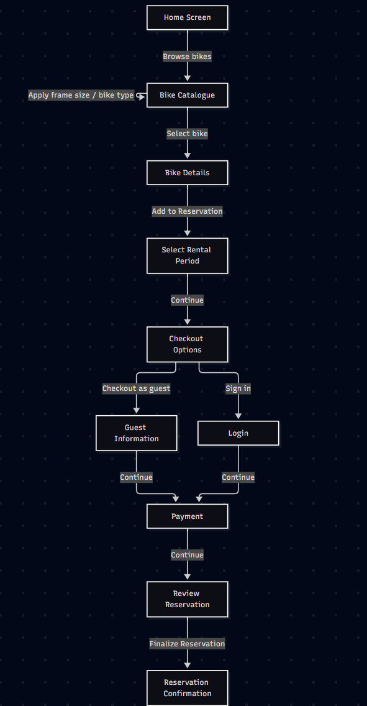

### Joe – Technician Removes and Restores a Bike

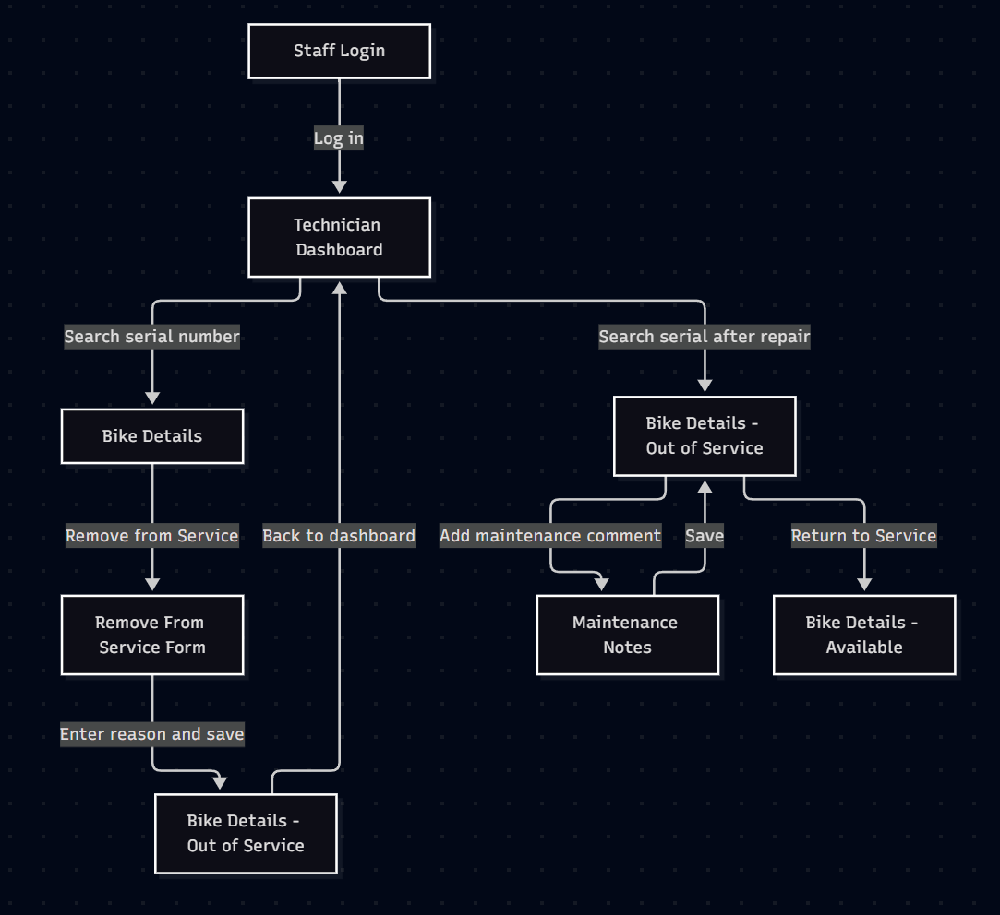

### Linda – Manager Cancels the Day's Reservations

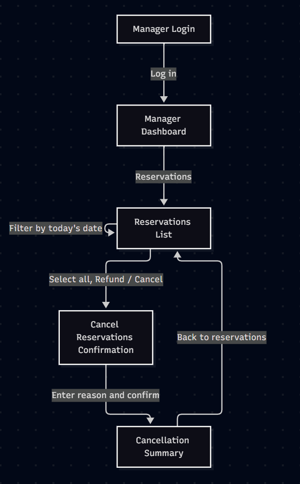

## Wireframes

**Use case:** Reserve Bike
**Actor:** Customer

These wireframes cover every screen a customer uses to reserve a bike, following Emily's scenario. Emily checks out as a guest; the Login screen covers the sign-in path for returning customers.

### 1. Home Screen

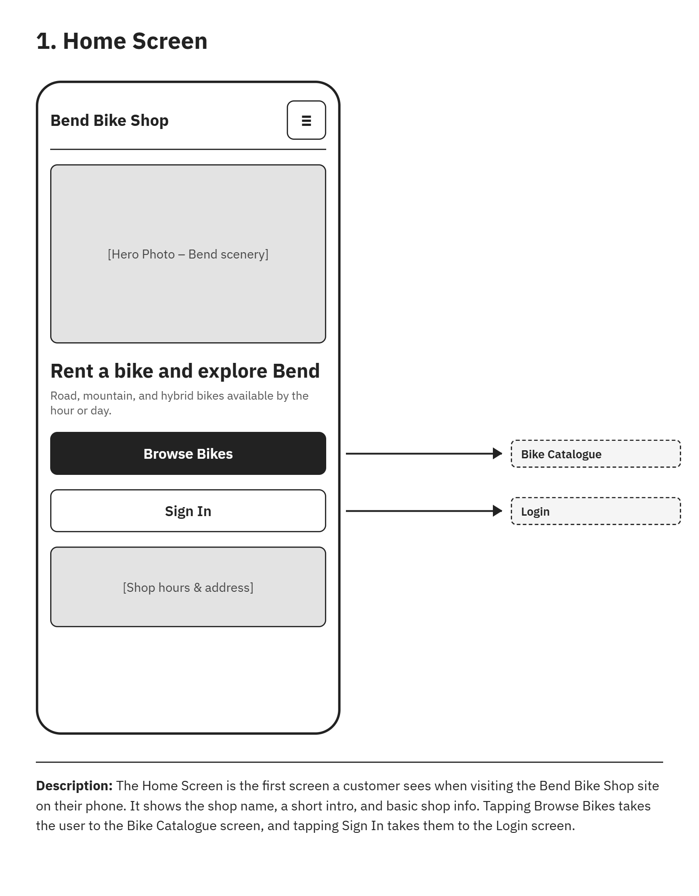

The Home Screen is the first screen a customer sees when visiting the Bend Bike Shop site on their phone. It shows the shop name, a short intro, and basic shop info. Tapping Browse Bikes takes the user to the Bike Catalogue screen, and tapping Sign In takes them to the Login screen.

### 2. Bike Catalogue

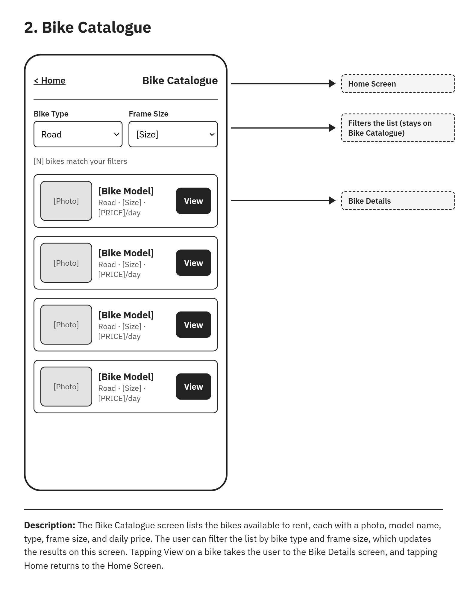

The Bike Catalogue screen lists the bikes available to rent, each with a photo, model name, type, frame size, and daily price. The user can filter the list by bike type and frame size, which updates the results on this screen. Tapping View on a bike takes the user to the Bike Details screen, and tapping Home returns to the Home Screen.

### 3. Bike Details

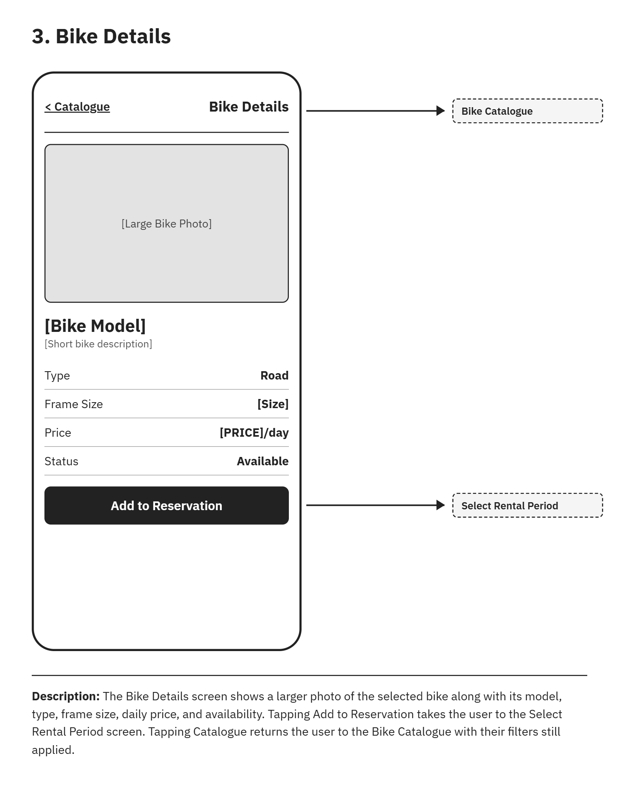

The Bike Details screen shows a larger photo of the selected bike along with its model, type, frame size, daily price, and availability. Tapping Add to Reservation takes the user to the Select Rental Period screen. Tapping Catalogue returns the user to the Bike Catalogue with their filters still applied.

### 4. Select Rental Period

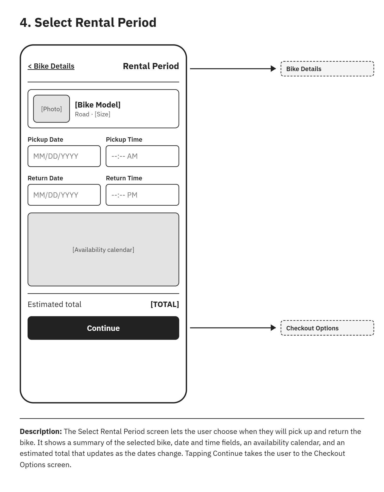

The Select Rental Period screen lets the user choose when they will pick up and return the bike. It shows a summary of the selected bike, date and time fields, an availability calendar, and an estimated total that updates as the dates change. Tapping Continue takes the user to the Checkout Options screen.

### 5. Checkout Options

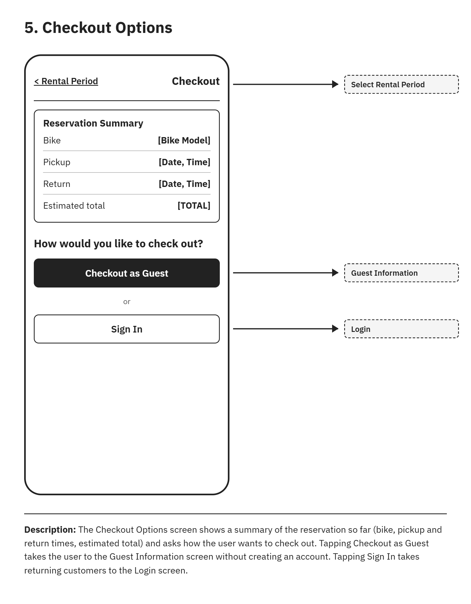

The Checkout Options screen shows a summary of the reservation so far (bike, pickup and return times, estimated total) and asks how the user wants to check out. Tapping Checkout as Guest takes the user to the Guest Information screen without creating an account. Tapping Sign In takes returning customers to the Login screen.

### 6. Guest Information

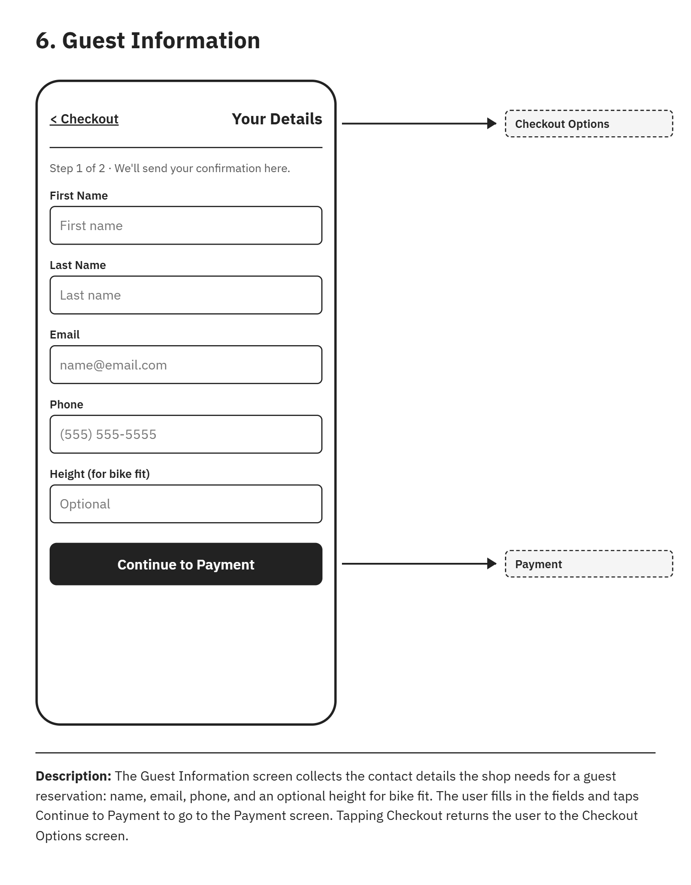

The Guest Information screen collects the contact details the shop needs for a guest reservation: name, email, phone, and an optional height for bike fit. The user fills in the fields and taps Continue to Payment to go to the Payment screen. Tapping Checkout returns the user to the Checkout Options screen.

### 7. Payment

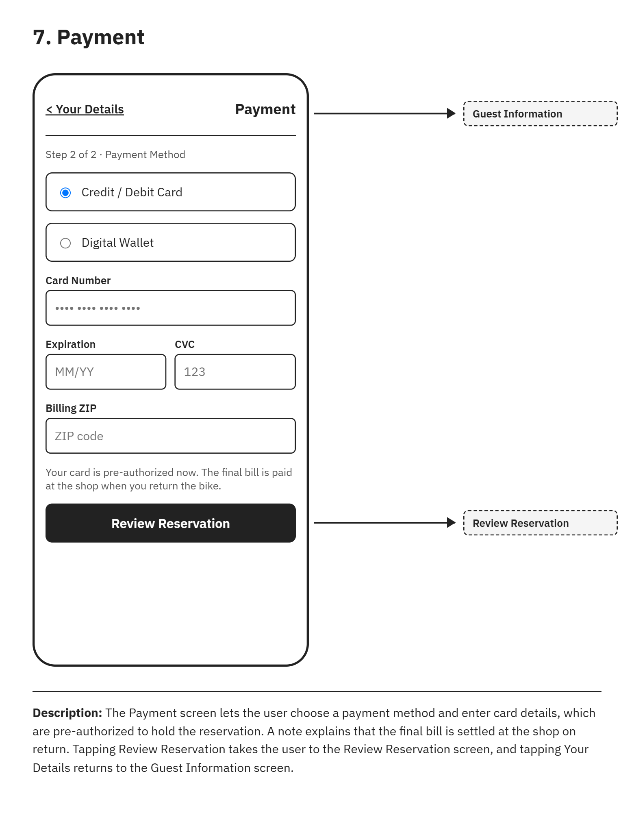

The Payment screen lets the user choose a payment method and enter card details, which are pre-authorized to hold the reservation. A note explains that the final bill is settled at the shop on return. Tapping Review Reservation takes the user to the Review Reservation screen, and tapping Your Details returns to the Guest Information screen.

### 8. Review Reservation

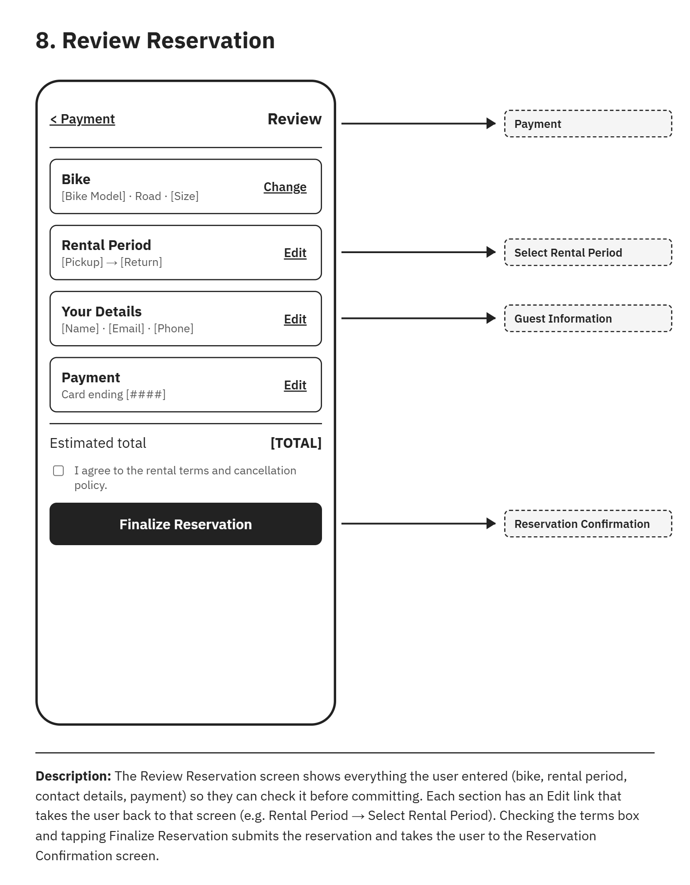

The Review Reservation screen shows everything the user entered (bike, rental period, contact details, payment) so they can check it before committing. Each section has an Edit link that takes the user back to that screen (e.g. Rental Period → Select Rental Period). Checking the terms box and tapping Finalize Reservation submits the reservation and takes the user to the Reservation Confirmation screen.

### 9. Reservation Confirmation

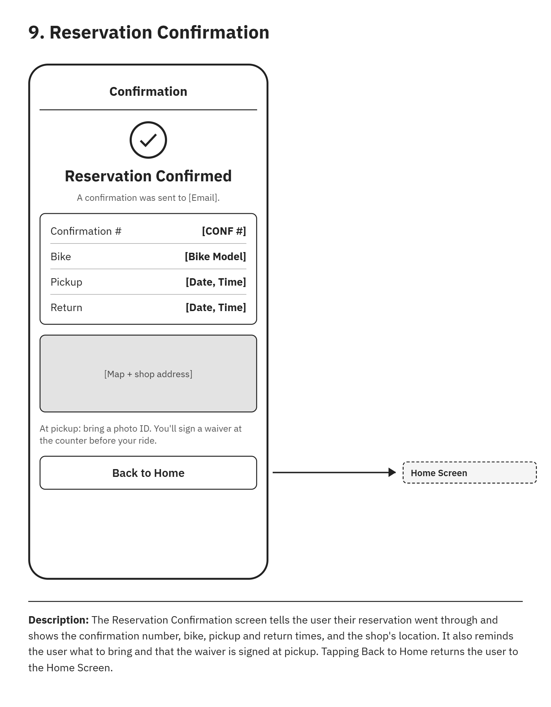

The Reservation Confirmation screen tells the user their reservation went through and shows the confirmation number, bike, pickup and return times, and the shop's location. It also reminds the user what to bring and that the waiver is signed at pickup. Tapping Back to Home returns the user to the Home Screen.

### 10. Login

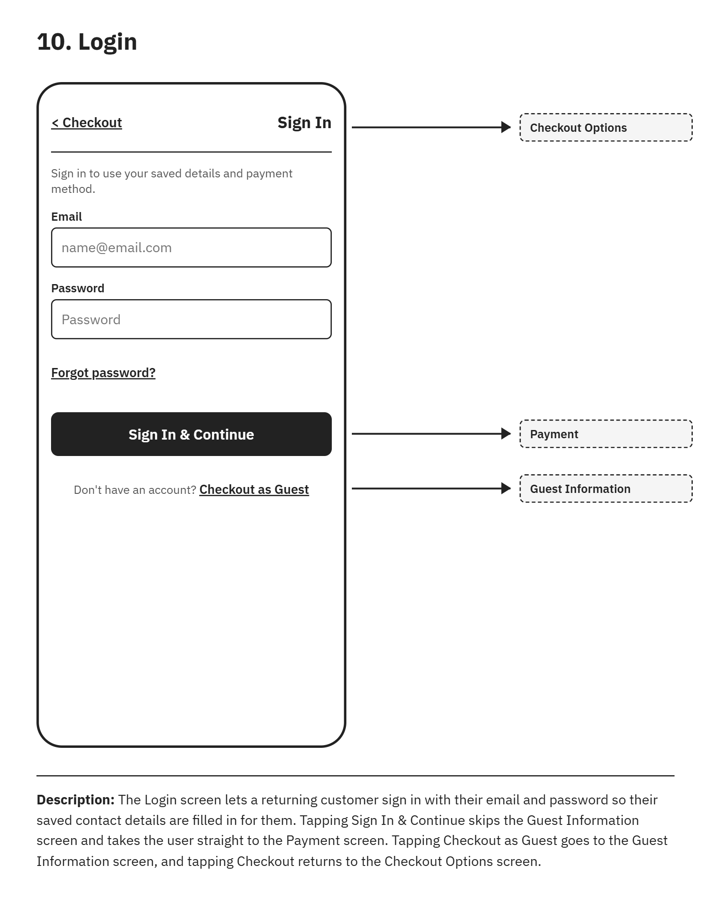

The Login screen lets a returning customer sign in with their email and password so their saved contact details are filled in for them. Tapping Sign In & Continue skips the Guest Information screen and takes the user straight to the Payment screen. Tapping Checkout as Guest goes to the Guest Information screen, and tapping Checkout returns to the Checkout Options screen.

## Prototype

A working prototype of the Reserve Bike use case (Emily's flow) is in [prototype.html](prototype.html). Download it and open it in a browser to click through the full reservation flow.
