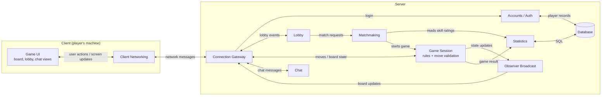

# Multiplayer Chess Component Diagram

**Assumptions**
- Players need accounts so stats and skill ratings persist between games.
- All client traffic goes through one gateway that routes it to the right component.
- The server owns game state and validates moves, so the client is just display and input.
