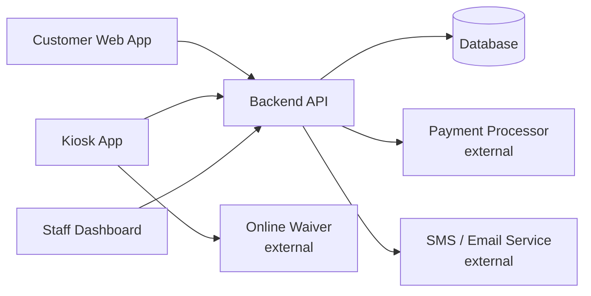

# Bend Bike Shop Technical Design Doc

## Overview

The Bend Bike Shop rental system lets customers browse available bikes and locks and reserve them online or at the in-store kiosk, with or without an account.  It also gives employees and managers the tools to track rentals, returns, and bikes out for service, process payments and late fees, and view reports on how the business is doing.  The system is cloud hosted and connects to an external payment processor, the shop's existing online waiver, and an SMS/email service.

## Actors

- **Customer:** Browses and reserves bikes and locks online or at the kiosk, as a guest or with an optional account.
- **Employee:** Handles bike handoffs and returns at the counter, checks bikes in and out, and can manually ban a customer (by name and phone).
- **Service Technician:** An employee who inspects returned bikes, removes bikes from service with notes, and returns them to service after repair.
- **Manager:** Everything an employee can do, plus refunds, overrides, bulk cancellations, discounts, reports, and managing employees.
- **Owner:** Full access, including managing managers.
- **External systems:** Payment processor, online waiver system, SMS/email service.

## Goals

- Customers can browse and filter bikes by type and frame size and reserve bikes and locks online or at the kiosk.
- Guest checkout is always available; account holders get autofilled details, saved cards, and "Rent Again."
- Cards are pre-authorized at reservation and charged at return, including late fees and cancellation fees.
- Availability shown to customers excludes bikes that are reserved or out for service.
- Technicians can remove a bike from service and restore it, with notes.
- Managers can bulk cancel or refund reservations with a recorded reason.
- Managers can set date-based discounts and manage employee accounts; the owner can manage managers.
- Managers and owners get a live dashboard plus weekly, monthly, and annual reports.
- Customers get a confirmation by SMS/email when they reserve.
- Customers get return reminders 1 hour before, at, and 1 hour after their return time.

## Non-Goals

- Bike and equipment sales (handled by a separate system)
- Outreach or marketing ads (handled by a separate team), and no ads on the kiosk
- Unattended pickups or returns outside business hours; all handoffs and returns go through an employee
- Self-service rental extensions; customers call and an employee decides
- Self-service bike swaps (e.g. wrong size); handled by an employee at the counter
- Automatic charges for lost or stolen bikes; a manager decides what to do
- Automatic discounts based on availability; only date-based discounts set by managers
- Discounts that need verification (e.g. student discounts); handled case-by-case at the counter
- Tracking helmets; they're free, optional, and not tracked
- Tracking locks individually; locks are tracked by count only
- Automatic weather cancellations; managers handle these through the override/refund tools
- Business-side cancellations due to inoperable bikes (tabled for later)
- Limits on how many bikes a customer can reserve; the per-bike cancellation fee covers abuse
- Required customer accounts; guest checkout must always be available
- Automatic customer bans; an employee must ban someone manually
- A built-in waiver system; the kiosk hooks into the existing online waiver
- Building payment or card pre-authorization in-house; handled by an external payment processor API
- Inventory purchasing or bike lifecycle tracking
- An on-premises server; the system will be cloud hosted

## Constraints

- Must be cloud hosted; no local server.
- Payments, pre-auths, and refunds go through the external payment processor API; the system never stores card numbers.
- Waivers use the shop's existing online waiver system.
- Guest checkout must always be available.
- Access is role-based (owner, manager, employee, with technicians as employees); only managers and owners can issue refunds or overrides.

## Assumptions

- At most 60 bikes are out at once, since the fleet is 60 bikes.
- A bike out for service now will be available by the next day.
- The payment processor supports pre-authorizing, re-authorizing a hold before pickup if it expires, releasing holds, and refunds.
- The shop's existing store serial numbers can be used as bike IDs.
- The shop has reliable internet for the kiosk and staff devices.

## Non-Functional Requirements

- 95% of page loads finish in under 2 seconds with 50 users on at once.
- 99.5% monthly uptime.
- The live dashboard reflects changes within 30 seconds.
- Return reminders go out within 5 minutes of the 1-hour-before, due, and 1-hour-late marks.
- Rental records are kept for at least 2 years.

## Component Diagram and Description

| Component | Description |
|---|---|
| Customer Web App | Mobile-friendly site where customers browse bikes, reserve, and pay as a guest or with an account.  Guests enter their name, email, and phone. |
| Kiosk App | In-store touchscreen version of the customer app.  Links to the online waiver, which customers sign at pickup; the employee confirms it before handoff. |
| Staff Dashboard | Used by employees, technicians, managers, and the owner, with access based on role: check-in/out, marking bikes out of service with notes, and for managers, reports, refunds, overrides, and discounts. |
| Backend API | Handles all business logic (availability, reservations, fees, roles) and connects the apps to the database and external services.  Also handles login and role checks, and runs scheduled jobs for return reminders. |
| Database | Stores bikes and service notes, lock counts, reservations, customers, staff accounts and roles, bans, discounts, payment processor tokens (never card numbers), refund/cancel reasons, and rental history. |
| Payment Processor | External service for card pre-authorizations, charges, and refunds. |
| SMS / Email Service | External service that sends confirmations and return reminders. |
| Online Waiver | The shop's existing external waiver system. |