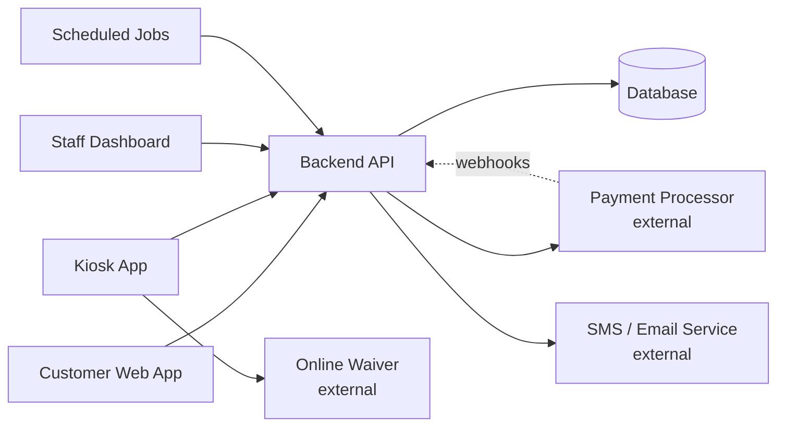
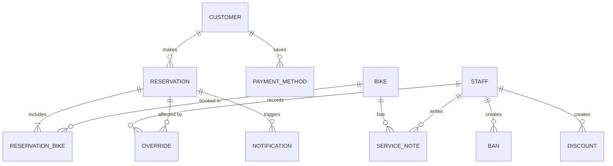
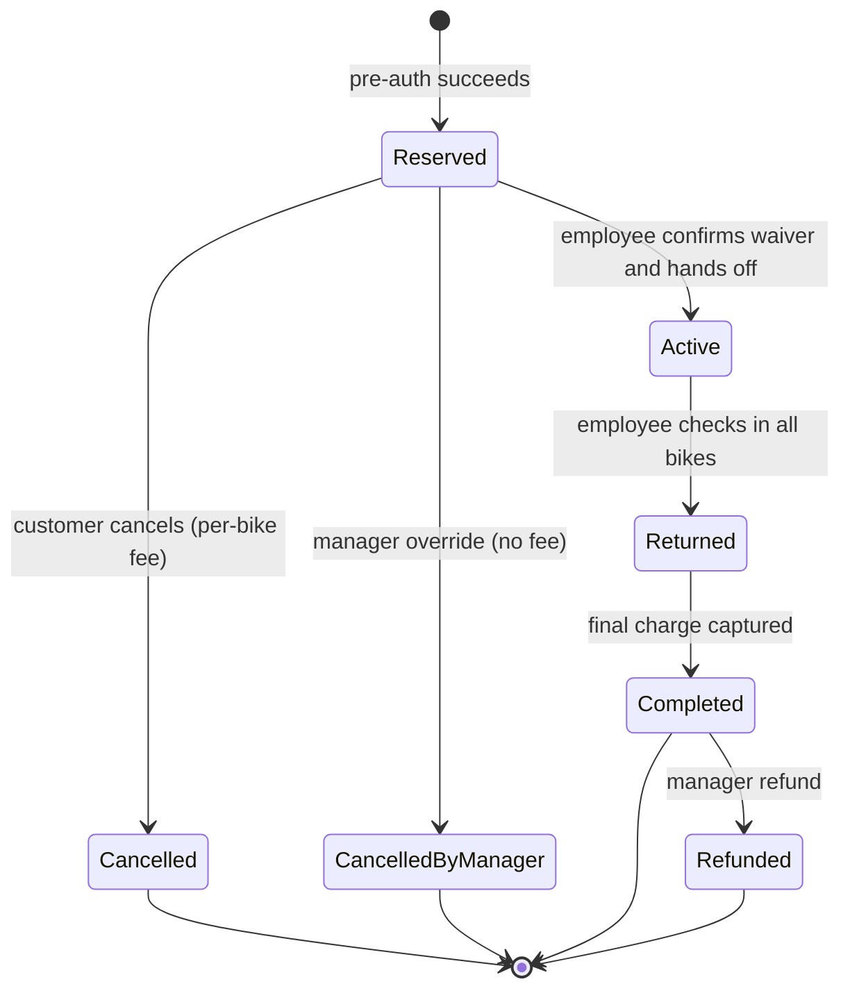
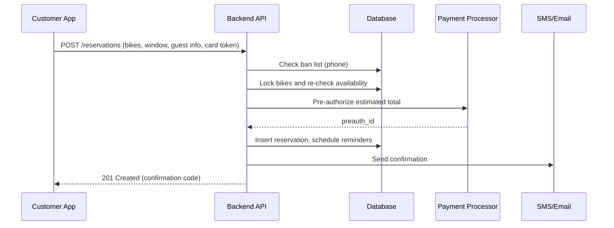
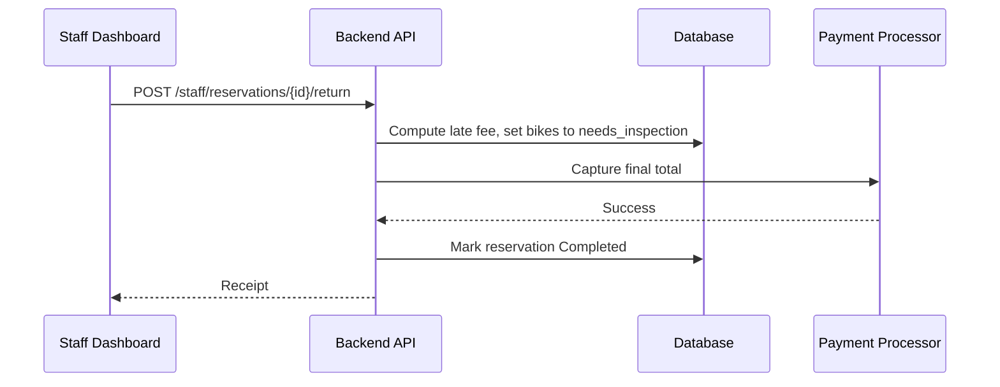
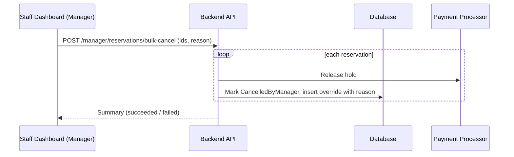

# Bend Bike Shop Technical Design Doc

## Overview

The Bend Bike Shop rental system lets customers browse available bikes and locks and reserve them online or at the in-store kiosk, with or without an account.  It also gives employees and managers the tools to track rentals, returns, and bikes out for service, process payments and late fees, and view reports on how the business is doing.  The system is cloud hosted and connects to an external payment processor, the shop's existing online waiver, and an SMS/email service.

## Actors

- **Customer:** Browses and reserves bikes and locks online or at the kiosk, as a guest or with an optional account.
- **Employee:** Handles bike handoffs and returns at the counter, checks bikes in and out, and can manually ban a customer (by name and phone).
- **Service Technician:** An employee who inspects returned bikes, removes bikes from service with notes, and returns them to service after repair.
- **Manager:** Everything an employee can do, plus refunds, overrides, bulk cancellations, discounts, reports, and managing employees.
- **Owner:** Full access, including managing managers.
- **External systems:** Payment processor, online waiver system, SMS/email service.

## Goals

- Customers can browse and filter bikes by type and frame size and reserve bikes and locks online or at the kiosk.
- Guest checkout is always available; account holders get autofilled details, saved cards, and "Rent Again."
- Cards are pre-authorized at reservation and charged at return, including late fees and cancellation fees.
- Availability shown to customers excludes bikes that are reserved or out for service.
- Technicians can remove a bike from service and restore it, with notes.
- Managers can bulk cancel or refund reservations with a recorded reason.
- Managers can set date-based discounts and manage employee accounts; the owner can manage managers.
- Managers and owners get a live dashboard plus weekly, monthly, and annual reports.
- Customers get a confirmation by SMS/email when they reserve.
- Customers get return reminders 1 hour before, at, and 1 hour after their return time.

## Non-Goals

- Bike and equipment sales (handled by a separate system)
- Outreach or marketing ads (handled by a separate team), and no ads on the kiosk
- Unattended pickups or returns outside business hours; all handoffs and returns go through an employee
- Self-service rental extensions; customers call and an employee decides
- Self-service bike swaps (e.g. wrong size); handled by an employee at the counter
- Automatic charges for lost or stolen bikes; a manager decides what to do
- Automatic discounts based on availability; only date-based discounts set by managers
- Discounts that need verification (e.g. student discounts); handled case-by-case at the counter
- Tracking helmets; they're free, optional, and not tracked
- Tracking locks individually; locks are tracked by count only
- Automatic weather cancellations; managers handle these through the override/refund tools
- Business-side cancellations due to inoperable bikes (tabled for later)
- Limits on how many bikes a customer can reserve; the per-bike cancellation fee covers abuse
- Required customer accounts; guest checkout must always be available
- Automatic customer bans; an employee must ban someone manually
- A built-in waiver system; the kiosk hooks into the existing online waiver
- Building payment or card pre-authorization in-house; handled by an external payment processor API
- Inventory purchasing or bike lifecycle tracking
- An on-premises server; the system will be cloud hosted

## Constraints

- Must be cloud hosted; no local server.
- Payments, pre-auths, and refunds go through the external payment processor API; the system never stores card numbers.
- Waivers use the shop's existing online waiver system.
- Guest checkout must always be available.
- Access is role-based (owner, manager, employee, with technicians as employees); only managers and owners can issue refunds or overrides.

## Assumptions

- At most 60 bikes are out at once, since the fleet is 60 bikes.
- A bike out for service now will be available by the next day.
- The payment processor supports pre-authorizing, re-authorizing a hold before pickup if it expires, releasing holds, and refunds.
- The shop's existing store serial numbers can be used as bike IDs.
- The shop has reliable internet for the kiosk and staff devices.

## Non-Functional Requirements

- 95% of page loads finish in under 2 seconds with 50 users on at once.
- 99.5% monthly uptime.
- The live dashboard reflects changes within 30 seconds.
- Return reminders go out within 5 minutes of the 1-hour-before, due, and 1-hour-late marks.
- Rental records are kept for at least 2 years.

## Component Diagram and Description

| Component | Description |
|---|---|
| Customer Web App | Mobile-friendly site where customers browse bikes, reserve, and pay as a guest or with an account.  Guests enter their name, email, and phone.  Card entry uses the payment processor's hosted fields so card numbers never touch our servers. |
| Kiosk App | In-store touchscreen version of the customer app.  Links to the online waiver, which customers sign at pickup; the employee confirms it before handoff.  Logs out automatically after 2 minutes of inactivity. |
| Staff Dashboard | Used by employees, technicians, managers, and the owner, with access based on role: check-in/out, marking bikes out of service with notes, and for managers, reports, refunds, overrides, and discounts.  Polls the API every 15 seconds for live data. |
| Backend API | Handles all business logic (availability, reservations, fees, roles) and connects the apps to the database and external services.  Also handles login and role checks.  Exposes a REST/JSON API over HTTPS. |
| Scheduled Jobs | Runs inside the backend on a timer: sends return reminders, renews expiring pre-auths, and builds report summaries. |
| Database | Stores bikes and service notes, lock counts, reservations, customers, staff accounts and roles, bans, discounts, payment processor tokens (never card numbers), refund/cancel reasons, and rental history.  Relational (e.g. PostgreSQL) so reservations and payments can be updated in a single transaction. |
| Payment Processor | External service for card pre-authorizations, charges, and refunds.  Sends webhooks for async results (e.g. failed captures). |
| SMS / Email Service | External service that sends confirmations and return reminders. |
| Online Waiver | The shop's existing external waiver system. |

## Data Model

| Table | Key Fields |
|---|---|
| bike | serial_number (PK), model, type, frame_size, daily_rate, photo_url, status (`available`, `rented`, `needs_inspection`, `out_of_service`) |
| service_note | id, bike_serial, staff_id, action (`removed`, `restored`, `note`), text, created_at |
| lock_inventory | total_count (single row) |
| customer | id, name, email, phone, address, height (optional), password_hash (null for guests), created_at |
| payment_method | id, customer_id, processor_token, card_brand, last4, expiry |
| reservation | id, confirmation_code, customer_id, pickup_at, return_at, status, lock_count, channel (`web`, `kiosk`), discount_id, subtotal, discount_amount, late_fee, cancel_fee, total, preauth_id, preauth_expires_at, waiver_confirmed_by, picked_up_at, returned_at |
| reservation_bike | reservation_id, bike_serial |
| staff | id, name, email, password_hash, role (`employee`, `technician`, `manager`, `owner`), active |
| ban | id, name, phone (normalized), reason, staff_id, created_at |
| discount | id, label, percent_off, start_date, end_date, created_by |
| override | id, staff_id, reservation_id, action (`cancel`, `refund`, `fee_waive`), amount, reason, created_at |
| notification | id, reservation_id, type (`confirmation`, `remind_before`, `remind_due`, `remind_late`), channel, scheduled_for, sent_at, status |

Notes:
- Guests get a `customer` row with no password so reservations always link to a customer.
- All money is stored as integer cents.
- Records are never hard-deleted; staff are deactivated, not removed, so history stays intact for 2+ years.

## Reservation Lifecycle

Bike status changes alongside the reservation:
- Handoff: bike → `rented`.
- Return: bike → `needs_inspection`.
- Technician passes inspection: bike → `available`.  Fails: bike → `out_of_service` with a required note.
- Technician restores: `out_of_service` → `available` with a required note.

## Availability Rules

A bike is available for a requested window when:
1. It has no `reservation_bike` row on a `Reserved` or `Active` reservation whose window overlaps the requested one, and
2. If the window starts today, its status is `available`.  For future dates, `needs_inspection` and `out_of_service` bikes still count as available (per the next-day service assumption).

Locks are available when `total_count` minus locks on overlapping `Reserved`/`Active` reservations is at least the requested count.

To prevent double booking, reservation creation re-checks availability inside a database transaction and locks the selected bike rows before inserting.  If a bike was taken in the meantime, the API returns `409 Conflict` and the app sends the user back to pick another.

## Pricing, Fees, and Payments

All rates and fees are stored as configurable settings, editable by managers.

| Item | Rule |
|---|---|
| Rental | daily_rate × rental days, with any partial day counted as one day |
| Lock | flat fee per lock per rental |
| Discount | If a discount's date range covers the pickup date, its percent comes off the rental subtotal.  If more than one applies, the largest wins. |
| Late fee | Charged per hour late (rounded up) after a 15-minute grace period |
| Cancellation fee | Charged per bike when the customer cancels; waived for manager cancellations |

Payment flow:
1. **Reserve:** API creates a pre-auth for the estimated total and stores the `preauth_id`.  Account holders can save the card as a processor token.
2. **Hold renewal:** If the hold expires before pickup, a scheduled job re-authorizes 24 hours before pickup.  If that fails, the customer is emailed to update their card and the reservation is flagged on the staff dashboard.
3. **Return:** API computes the final total and captures it against the hold.  If the final total is higher than the hold (e.g. late fees), the hold is captured and the difference is charged to the same token.
4. **Customer cancel:** Hold is released and the cancellation fee is charged.
5. **Manager cancel/refund:** Hold is released or the payment refunded, and an `override` row stores the staff member and reason.

## Key Flows

### Reserve a Bike (Emily)

### Return and Final Charge

### Bulk Cancel (Linda)

Each reservation in a bulk cancel is processed independently, so one failed hold release doesn't block the rest.  Failures are listed in the summary for the manager to retry.

## API Endpoints

All endpoints use JSON over HTTPS.  Staff endpoints require a logged-in staff session with the listed minimum role.

| Method | Path | Role | Purpose |
|---|---|---|---|
| GET | /bikes?type=&size=&start=&end= | Public | List bikes, filtered, with availability for the window |
| GET | /bikes/{serial} | Public | Bike details |
| POST | /quotes | Public | Estimated total for bikes, locks, and window |
| POST | /reservations | Public | Create reservation (guest or account) |
| GET | /reservations/{code}?phone= | Public | Look up a reservation |
| POST | /reservations/{code}/cancel | Public | Customer cancel (applies fee) |
| POST | /auth/register, /auth/login, /auth/logout | Public | Customer account (login by email or phone) |
| GET | /me/reservations | Customer | Past and upcoming rentals, used for "Rent Again" |
| GET/DELETE | /me/payment-methods | Customer | Saved cards |
| GET | /staff/reservations?date= | Employee | Today's pickups and returns |
| POST | /staff/reservations/{id}/checkout | Employee | Confirm waiver and hand off |
| POST | /staff/reservations/{id}/return | Employee | Check in and capture payment |
| POST | /staff/bikes/{serial}/notes | Technician | Add a service note |
| POST | /staff/bikes/{serial}/inspect | Technician | Pass inspection → available |
| POST | /staff/bikes/{serial}/remove | Technician | Out of service (note required) |
| POST | /staff/bikes/{serial}/restore | Technician | Back to available (note required) |
| POST | /staff/bans | Employee | Ban by name and phone |
| POST | /manager/reservations/bulk-cancel | Manager | Cancel many with one reason |
| POST | /manager/reservations/{id}/refund | Manager | Full or partial refund with reason |
| POST | /manager/reservations/{id}/waive-fee | Manager | Waive late or cancel fee with reason |
| GET/POST/PUT | /manager/discounts | Manager | Date-based discounts |
| GET | /manager/dashboard | Manager | Live counts: today's reservations, bikes out, out of service, revenue |
| GET | /manager/reports?period=weekly\|monthly\|annual&start= | Manager | Revenue, rentals, utilization, cancellations |
| GET/POST/PUT | /manager/staff | Manager | Manage employees and technicians |
| GET/POST/PUT | /owner/managers | Owner | Manage managers |
| POST | /webhooks/payments | Processor | Async payment results (signature verified) |

## Roles and Permissions

| Action | Employee | Technician | Manager | Owner |
|---|---|---|---|---|
| Check out / return bikes | ✓ | ✓ | ✓ | ✓ |
| Ban a customer | ✓ | ✓ | ✓ | ✓ |
| Service notes, remove/restore bikes | | ✓ | ✓ | ✓ |
| Refunds, overrides, fee waivers, bulk cancel | | | ✓ | ✓ |
| Discounts, dashboard, reports | | | ✓ | ✓ |
| Manage employees and technicians | | | ✓ | ✓ |
| Manage managers | | | | ✓ |

Role checks happen in the Backend API on every request; the apps hide controls by role but aren't trusted to enforce them.

## Scheduled Jobs

| Job | Frequency | Action |
|---|---|---|
| Send reminders | Every minute | Send any `notification` rows due and not yet sent (meets the 5-minute NFR) |
| Renew pre-auths | Hourly | Re-authorize holds that expire before pickup and are within 24 hours of it |
| Report rollups | Nightly | Pre-compute daily totals so weekly/monthly/annual reports load fast |

Reminder rows are created when the reservation is made and updated if staff change the return time.  The late reminder is skipped if the bike has already been returned.

## Security

- Passwords (customer and staff) are hashed with a slow algorithm (e.g. bcrypt).
- Login is rate-limited to 5 failed attempts per 15 minutes per account.
- Card data is entered only into the processor's hosted fields; the database stores tokens and last4 only.
- Payment webhooks are verified by signature.
- Banned phone numbers are checked at reservation time; a match blocks the reservation with a "please see staff" message rather than revealing the ban.
- Every override, refund, ban, and service status change stores the staff member and timestamp.

## Open Questions

- Should rentals shorter than a day (e.g. Marcus's 10am–2pm) be priced hourly instead of a full day?
- What happens when a customer doesn't show up for pickup (keep the hold, charge a fee, or auto-cancel)?
- If a bike is booked for tomorrow but still out of service, how is the customer handled, given business-side cancellations are tabled?
- How large a pre-auth buffer should be added to cover likely late fees?
