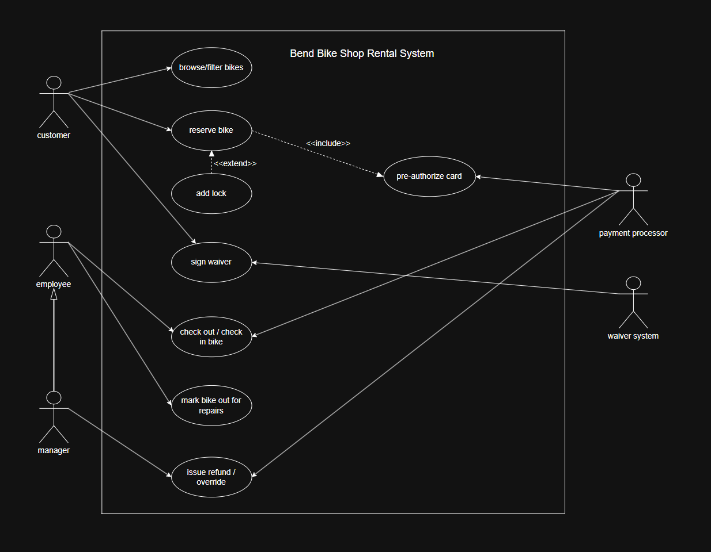

# Bend Bike Shop Functional Spec

## Section 1: Write an Overview

The Bend Bike Shop rental system lets customers browse available bikes and locks and reserve them online or at the in-store kiosk, with or without an account. It also gives employees and managers the tools to track rentals, returns, and bikes out for service, process payments and late fees, and view reports on how the business is doing.

## Section 2: Write User Scenarios

Emily is an active long distance bike riding enthusiast who is visiting Bend to see some family while on vacation. She decides she wants to go on a bike ride around Bend to see the sights while she's in town, and because she's already a seasoned bike rider, she decides to browse the Bend Bike Shop catalogue from her cell phone for a road bike. She browses the catalogue and is able to find exactly what she is looking for because the system allows the user to filter the available bikes based on frame size and bike type. She clicks the exact bike she wants, clicks add to reservation, picks her rental time frame, decides to checkout as a guest, fills out her personal details and enters her desired payment method, clicks finalize reservation, arrives on time to the shop and her bike is waiting for her when she gets there. She signs a waiver, goes out and has a good experience seeing everything she wanted to around town, returns her bike on time without any issue, pays her bill with a shop employee’s assistance and goes back to her family to express how much she enjoyed the rental process at the Bend Bike Shop, and ends up leaving a glowing review online because of how smooth and seamless the store's rental system is.

Joe is a service technician working at the Bend Bike Shop. He handles maintenance on the bikes returning from customer use and is the one in charge of final inspection before a bike can be checked back into inventory so the bikes can be rented out again. He is in the process of inspecting a bike and notices one of the sprockets in the gear stack is beginning to rust pretty badly, and decides to flag the bike and make sure it cannot go back out into service until the new sprocket is ordered and replaced so the bike doesn't have any issues when a customer is out riding it. He searches the bike’s serial number to pull up its page, clicks a button that removes the bike from service, enters the reasons into the text field, and saves it in the system. Once the new parts arrive, Joe replaces the worn rusty sprocket, pulls up the bike in the system, adds a comment into the text field saying the rusty worn out sprocket has been replaced, clicks save and clicks a button that moves the bike back into the shop’s available bikes. The system made Joe's job easy to keep track of which bikes are not in service and what repairs are needed for each bike.

Linda has managed the Bend Bike Shop for six years and has learned that August in Bend means one thing: wildfire smoke. She wakes up on a Saturday to an orange sky and an air quality alert, and she knows no one is riding today. She logs into the manager dashboard from her laptop, which shows a live summary of today’s activity: 22 reservations and 0 bikes out. She clicks “Reservations,” filters by today’s date, and sees the full list of customers. She clicks “Select All,” then “Refund / Cancel,” and a confirmation box asks her to enter a reason. She types “Store closed – wildfire smoke” and confirms. The system cancels the reservations without cancellation fees, releases the card pre-authorizations, and records the override and its reason under her manager account. Linda spends the rest of the morning answering exactly zero angry phone calls.

Marcus, a retired schoolteacher, rented a hybrid last summer and liked it enough to make an account. This year he walks up to the in-store kiosk, taps “Log In,” and enters his phone number and password. His home screen shows his past rentals, with a “Rent Again” button next to last year’s hybrid. He taps it, and the system brings up the bike type and size he used before. He picks today, 10am–2pm. On the availability screen, mountain bikes in his size are grayed out for that block, but hybrids are available. He picks one, taps “Add Lock” for a small fee, and moves to checkout. His name, address, phone, and saved card fill in automatically, so he just confirms the payment pre-authorization and taps “Reserve.” The confirmation screen tells him to see an employee at the counter. The employee scans the reservation, hands him the bike, helmet, and lock, and Marcus is out the door in under five minutes.

## Section 3: Write Non-Goals

- Bike and equipment sales (handled by a separate system)
- Outreach or marketing ads (handled by a separate team), and no ads on the kiosk
- Unattended pickups or returns outside business hours; all handoffs and returns go through an employee
- Self-service rental extensions; customers call and an employee decides
- Self-service bike swaps (e.g. wrong size); handled by an employee at the counter
- Automatic charges for lost or stolen bikes; a manager decides what to do
- Automatic discounts based on availability; only date-based discounts set by managers
- Discounts that need verification (e.g. student discounts); handled case-by-case at the counter
- Tracking helmets; they're free, optional, and not tracked
- Tracking locks individually; locks are tracked by count only
- Automatic weather cancellations; managers handle these through the override/refund tools
- Business-side cancellations due to inoperable bikes (tabled for later)
- Limits on how many bikes a customer can reserve; the per-bike cancellation fee covers abuse
- Required customer accounts; guest checkout must always be available
- Automatic customer bans; an employee must ban someone manually
- A built-in waiver system; the kiosk hooks into the existing online waiver
- Building payment or card pre-authorization in-house; handled by an external payment processor API
- Inventory purchasing or bike lifecycle tracking
- An on-premises server; the system will be cloud hosted

## Section 4: Use Case Diagrams

