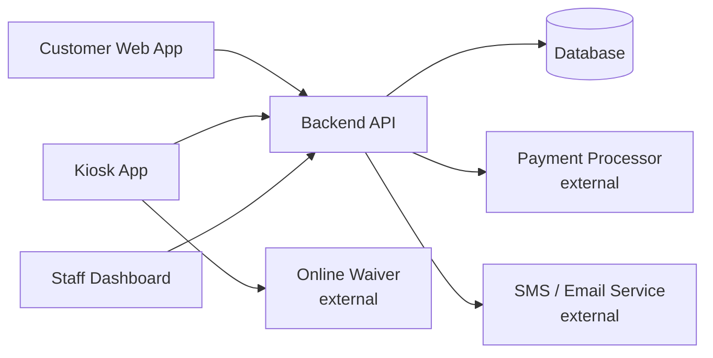
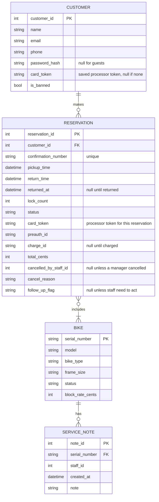
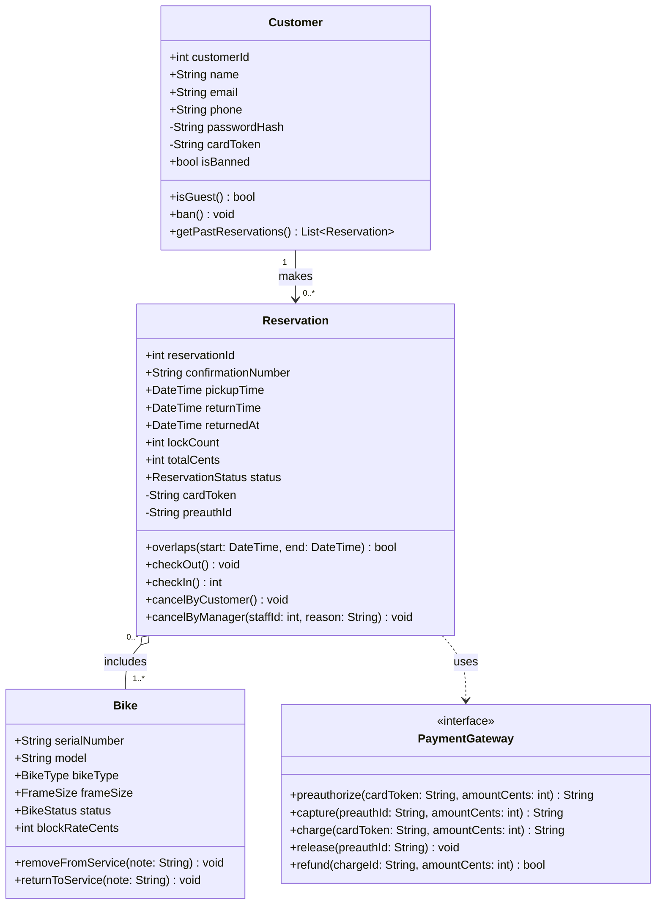

# Bend Bike Shop Technical Design Doc


## Overview

The Bend Bike Shop rental system lets customers browse available bikes and locks and reserve them online or at the in-store kiosk, with or without an account.  It also gives employees and managers the tools to track rentals, returns, and bikes out for service, process payments and late fees, and view reports on how the business is doing.  The system is cloud hosted and connects to an external payment processor, the shop's existing online waiver, and an SMS/email service.

## Actors

- **Customer:** Browses and reserves bikes and locks online or at the kiosk, as a guest or with an optional account.
- **Employee:** Handles bike handoffs and returns at the counter, checks bikes in and out, marks bikes out of service or back in service with notes, and can manually ban a customer (by name and phone).
- **Service Technician:** An employee who inspects returned bikes, removes bikes from service with notes, and returns them to service after repair.
- **Manager:** Everything an employee can do, plus refunds, overrides, bulk cancellations, discounts, reports, and managing employees.
- **Owner:** Full access, including managing managers.
- **External systems:** Payment processor, online waiver system, SMS/email service.

## Goals

- Customers can browse and filter bikes by type and frame size and reserve bikes and locks online or at the kiosk.
- Guest checkout is always available; account holders get autofilled details, saved cards, and "Rent Again."
- Cards are pre-authorized at reservation and charged at return, including any late fees.  Cancellation fees are charged when the customer cancels.
- Employees can check bikes out and in, and can manually ban a customer by name and phone.
- Availability shown to customers excludes bikes that are reserved or out for service.
- Technicians can remove a bike from service and restore it, with notes.
- Managers can bulk cancel or refund reservations with a recorded reason.
- Managers can set date-based discounts and manage employee accounts; the owner can manage managers.
- Managers and owners get a live dashboard plus weekly, monthly, and annual reports.
- Customers get a confirmation by SMS/email when they reserve.
- Customers get return reminders 1 hour before, at, and 1 hour after their return time.

## Non-Goals

- Bike and equipment sales (handled by a separate system)
- Outreach or marketing ads (handled by a separate team), and no ads on the kiosk
- Unattended pickups or returns outside business hours; all handoffs and returns go through an employee
- Self-service rental extensions; customers call and an employee decides
- Self-service bike swaps (e.g. wrong size); handled by an employee at the counter
- Automatic charges for lost or stolen bikes; a manager decides what to do
- Automatic discounts based on availability; only date-based discounts set by managers
- Discounts that need verification (e.g. student discounts); handled case-by-case at the counter
- Tracking helmets; they're free, optional, and not tracked
- Tracking locks individually; locks are tracked by count only
- Automatic weather cancellations; managers handle these through the override/refund tools
- Business-side cancellations due to inoperable bikes (tabled for later)
- Limits on how many bikes a customer can reserve; the per-bike cancellation fee covers abuse
- Required customer accounts; guest checkout must always be available
- Automatic customer bans; an employee must ban someone manually
- A built-in waiver system; the kiosk hooks into the existing online waiver
- Building payment or card pre-authorization in-house; handled by an external payment processor API
- Inventory purchasing or bike lifecycle tracking
- An on-premises server; the system will be cloud hosted

## Constraints

- Must be cloud hosted; no local server.
- Payments, pre-auths, and refunds go through the external payment processor API; the system never stores card numbers.
- Waivers use the shop's existing online waiver system.
- Guest checkout must always be available.
- Access is role-based (owner, manager, employee, with technicians as employees); only managers and owners can issue refunds or overrides.

## Assumptions

- Peak load is about 60 rentals a day, based on the 60-bike fleet.
- A bike out for service now will be available by the next day.
- The payment processor supports pre-authorizing, re-authorizing a hold before pickup if it expires, releasing holds, and refunds.
- The shop's existing store serial numbers can be used as bike IDs.
- The shop has reliable internet for the kiosk and staff devices.

## Non-Functional Requirements

- 95% of page loads finish in under 2 seconds with 50 users on at once.
- 99.5% monthly uptime.
- The live dashboard reflects changes within 30 seconds.
- Return reminders go out within 5 minutes of the 1-hour-before, due, and 1-hour-late marks.
- Rental records are kept for at least 2 years.

## Component Diagram and Description



| Component | Description |
|---|---|
| Customer Web App | Mobile-friendly site where customers browse bikes, reserve, and pay as a guest or with an account.  Guests enter their name, email, and phone. |
| Kiosk App | In-store touchscreen version of the customer app.  Links to the online waiver, which customers sign at pickup; the employee confirms it before handoff. |
| Staff Dashboard | Used by employees, technicians, managers, and the owner, with access based on role: check-in/out, marking bikes out of service with notes, and for managers, reports, refunds, overrides, and discounts. |
| Backend API | Handles all business logic (availability, reservations, fees, roles) and connects the apps to the database and external services.  Also handles login and role checks, and runs scheduled jobs for return reminders, card hold renewals, and notification retries. |
| Database | Stores bikes and service notes, lock counts, reservations, customers, staff accounts and roles, bans, discounts, payment processor tokens (never card numbers), refund/cancel reasons, and rental history. |
| Payment Processor | External service for card pre-authorizations, charges, and refunds. |
| SMS / Email Service | External service that sends confirmations and return reminders. |
| Online Waiver | The shop's existing external waiver system. |

## Data Model

### Entity Relationship Diagram

Guests and account holders share the `CUSTOMER` table.  Guests have no password or saved card.  Each reservation keeps its own card token, so guests can still be re-authorized or charged later.  Locks aren't tracked individually, so a reservation stores a lock count.  Money is stored as integer cents, and times are stored in UTC.  Staff, discounts, and the reservation-to-bike junction table are left out of this sample.



### Class Diagram



## Interfaces

These are functions on the Backend API.  For staff functions, the API gets the staff member from their login session and checks their role, so a caller can't claim to be someone else.

**Non-primitive types:**

- `DateTime`: a point in time, stored in UTC and shown in the shop's local time (Pacific).
- `BikeType`: one of `ROAD`, `MOUNTAIN`, `HYBRID`.
- `FrameSize`: one of `XS`, `S`, `M`, `L`, `XL`.
- `BikeStatus`: one of `IN_SERVICE`, `OUT_OF_SERVICE`.  Whether a bike is rented out comes from its reservations, not this field.
- `ReservationStatus`: one of `RESERVED`, `CHECKED_OUT`, `RETURNED`, `CANCELLED`.
- `ContactInfo`: a record with `name: string`, `email: string`, `phone: string`.
- `Bike`: a record with `serial_number: string`, `model: string`, `bike_type: BikeType`, `frame_size: FrameSize`, `status: BikeStatus`, `block_rate_cents: int`.
- `Reservation`: a record with `reservation_id: int`, `confirmation_number: string`, `customer: ContactInfo`, `serial_numbers: List<string>`, `lock_count: int`, `pickup_time: DateTime`, `return_time: DateTime`, `status: ReservationStatus`, `total_cents: int`.
- `List<T>`: an ordered list of values of type `T`, possibly empty.

Money is always an `int` in cents.  The lock fee, late fee, and discounts are shop settings that managers can change.

### search_available_bikes

```
search_available_bikes(bike_type: BikeType | null, frame_size: FrameSize | null,
                       pickup_time: DateTime, return_time: DateTime) -> List<Bike>
```

- **Purpose:** Returns the bikes a customer can reserve for a time range, with optional filters.
- **Requires:** `pickup_time` is in the future and before `return_time`, both are during business hours, and the range is 7 days or less.
- **Outcomes:** Returns every bike that matches the filters and is free for the whole range.  A null filter matches everything.  Returns an empty list if nothing matches.
- **Guarantees:** Never returns a bike that is on another `RESERVED` or `CHECKED_OUT` reservation that overlaps the range.  Never returns an `OUT_OF_SERVICE` bike for a same-day pickup.  Read-only; changes nothing.
- **Notes:** Following the next-day service assumption, an `OUT_OF_SERVICE` bike can still be booked for a later day.  If it isn't fixed in time, `set_bike_service_status` flags the reservation.  The result is a snapshot, so `create_reservation` re-checks availability.

### calculate_rental_price

```
calculate_rental_price(serial_numbers: List<string>, lock_count: int,
                       pickup_time: DateTime, return_time: DateTime) -> int
```

- **Purpose:** Computes the estimated total in cents for a set of bikes, locks, and a time range.
- **Requires:** Every serial number exists, `lock_count` is 0 or more, and the range follows the same rules as `search_available_bikes`.
- **Outcomes:** For each bike, the rental is split into 24-hour periods starting at pickup.  Each period is charged at the bike's 4-hour block rate, with partial blocks rounded up, and capped at 3 blocks (the 12-hour rate).  Then the lock fee is added for each lock, and any discount for the pickup date comes off.  Returns the total.
- **Guarantees:** Read-only.  Doesn't include late fees.
- **Notes:** Shown as the estimated total on the rental period screen.  `create_reservation` saves this amount as `total_cents` and uses it for the pre-auth, so later discount changes don't affect existing reservations.

### create_reservation

```
create_reservation(customer_id: int | null, contact: ContactInfo, serial_numbers: List<string>,
                   lock_count: int, pickup_time: DateTime, return_time: DateTime,
                   card_token: string) -> Reservation
```

- **Purpose:** Reserves one or more bikes and locks for a customer and holds the payment.
- **Requires:** `serial_numbers` has at least one bike, the range follows the same rules as `search_available_bikes`, and `card_token` is a processor token.  `customer_id` is null for guests.
- **Outcomes:** Checks that the bikes are still free and that no banned customer has the same name and phone.  It then pre-authorizes the card for the estimated total, saves the reservation as `RESERVED` with its card token, sends a confirmation by SMS/email, and returns the reservation.  If a bike was taken, the customer is banned, or the pre-auth fails, it returns an error and nothing is saved.
- **Guarantees:** All or nothing: either every bike is reserved and the hold is placed, or nothing changes.  If the hold succeeds but saving fails, the hold is released.  No bike ends up on two overlapping reservations.
- **Notes:** The availability check and save run in one database transaction that locks the selected bike rows.  The pre-auth happens before that transaction starts, so locks aren't held during the network call.  A failed confirmation message doesn't undo the reservation; the confirmation number is also shown on screen.

### check_in_reservation

```
check_in_reservation(reservation_id: int) -> int
```

- **Purpose:** Records a return and charges the final bill.
- **Requires:** A staff member is logged in.
- **Outcomes:** Records the return time from the server clock, sets the reservation to `RETURNED`, and computes the final total: the saved `total_cents` plus any late fee.  It captures the hold for up to the hold amount and charges any extra to the reservation's card token.  Returns the amount charged in cents.  If the reservation isn't `CHECKED_OUT`, it returns an error.  If payment fails, the reservation is still marked returned and flagged on the staff dashboard as unpaid.
- **Guarantees:** The customer is charged at most once for the rental.  The return time can't be supplied by the caller, so late fees can't be avoided by backdating.  The return is saved even if payment fails.
- **Notes:** If a bike needs repair, the employee marks it out of service with `set_bike_service_status`.  Damage and missing bikes are handled by the employee and manager, not charged automatically.

### set_bike_service_status

```
set_bike_service_status(serial_number: string, in_service: bool, note: string) -> Bike
```

- **Purpose:** Removes a bike from service or puts it back, with a note.
- **Requires:** A staff member is logged in and `note` isn't empty.
- **Outcomes:** Sets the bike to `IN_SERVICE` or `OUT_OF_SERVICE`, saves the note with the staff ID and time, and returns the updated bike.  Returns an error if the bike doesn't exist.  If a bike going out of service has an upcoming reservation, that reservation is flagged on the staff dashboard.
- **Guarantees:** Every status change has a note attached.  Old notes are never edited or deleted.
- **Notes:** Any employee can do this, not just technicians.  A flagged reservation lets an employee swap bikes at the counter.

### bulk_cancel_reservations

```
bulk_cancel_reservations(reservation_ids: List<int>, reason: string) -> List<Reservation>
```

- **Purpose:** Lets a manager cancel many reservations at once without cancellation fees, such as when the shop closes for wildfire smoke.
- **Requires:** The logged-in staff member is a manager or owner, and `reason` isn't empty.
- **Outcomes:** For each reservation that is `RESERVED`, sets it to `CANCELLED`, releases the card hold, records the manager and reason, and notifies the customer by SMS/email.  Reservations that aren't `RESERVED` are skipped.  Returns the reservations that were cancelled.  If a hold release fails, that reservation is still cancelled and flagged for follow-up.
- **Guarantees:** No cancellation fee is charged.  Every cancellation is recorded with the manager's ID and the reason.
- **Notes:** Each reservation is handled on its own, so one failure doesn't stop the rest.

## Invariants

1. **No double booking.**  A bike is never on two `RESERVED` or `CHECKED_OUT` reservations whose time ranges overlap.
2. **Rental length.**  Every reservation's pickup time is before its return time, and the rental is 7 days or less.
3. **No card numbers stored.**  The database only stores payment processor tokens, pre-auth IDs, and charge IDs, never card numbers.
4. **Overrides are recorded.**  Every refund, manager cancellation, and override has a staff ID and a non-empty reason saved with it.

## Failure Modes

| Failure Mode | Cause | Effect | Detection | Mitigation |
|---|---|---|---|---|
| Payment processor is down | Outage or network error on the processor's side | Customers can't reserve because the pre-auth fails, and returns can't be charged | API gets errors or timeouts from the processor | Show the customer a "try again shortly" message without saving the reservation.  At return, mark the reservation returned and flag it as unpaid so staff can charge the saved card token later. |
| Pre-auth hold expires before pickup | Customer reserved far ahead and the card hold timed out | The shop has no guaranteed payment when the customer shows up | Scheduled job checks holds before pickup | Re-authorize with the reservation's card token 24 hours before pickup.  If that fails, flag the reservation on the staff dashboard so the employee collects a new card at pickup. |
| SMS/email service is down | Outage at the notification provider | Customers miss confirmations or return reminders, which can lead to late returns | API gets errors from the service | Retry each message within the 5-minute reminder window, then log it as failed.  Confirmation numbers are also shown on screen, so customers still have them. |
| Two customers reserve the last bike at once | Web and kiosk bookings for the same bike at the same moment | Both could get a confirmation for one bike | Availability re-check in `create_reservation` finds the conflict | Re-check and save in one transaction that locks the bike rows.  The second customer gets an error, their hold is released, and they're sent back to pick another bike. |