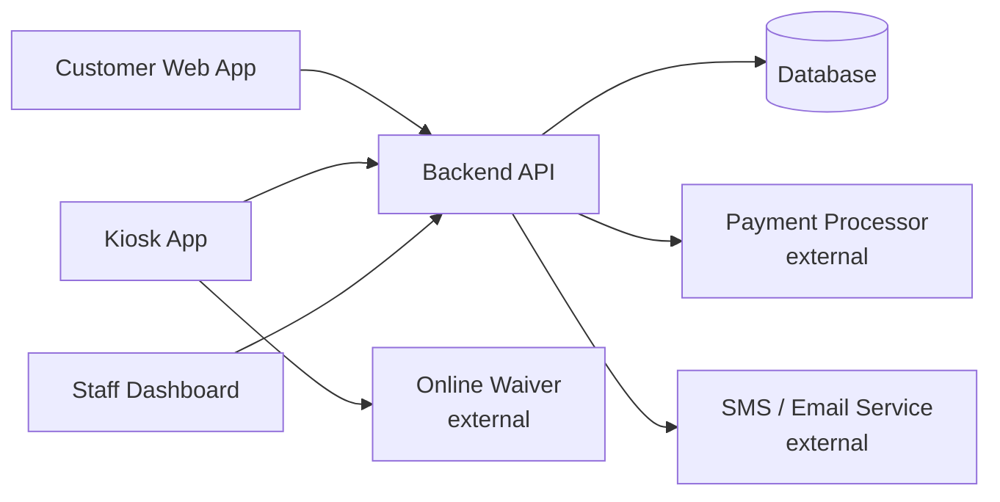
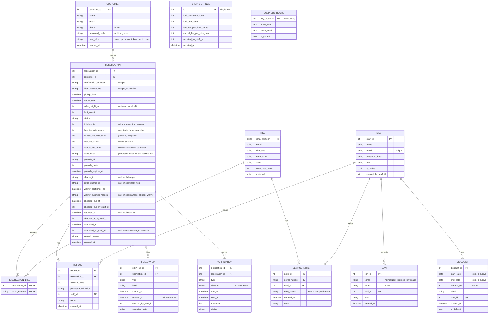
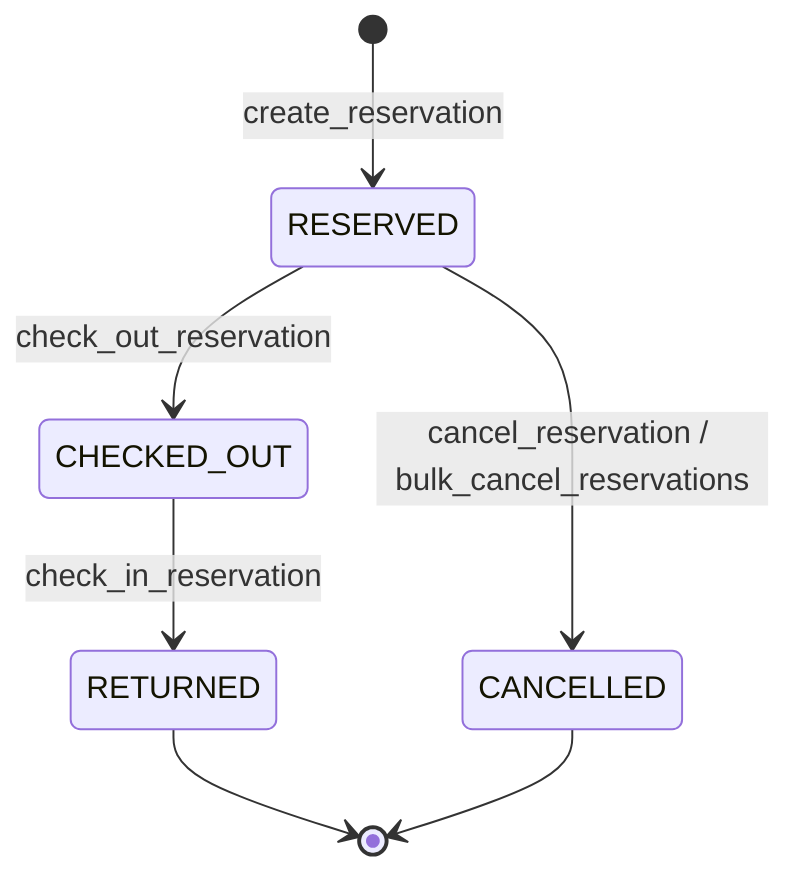
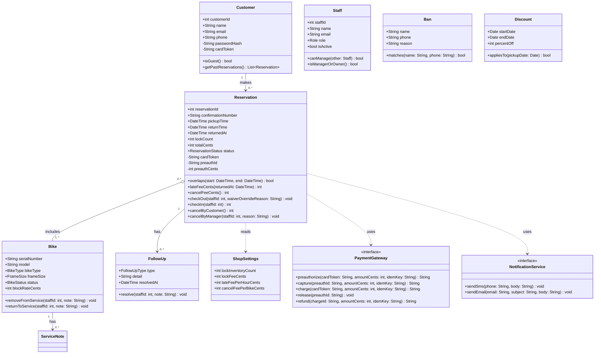

# Bend Bike Shop Technical Design Doc


## Overview

The Bend Bike Shop rental system lets customers browse available bikes and locks and reserve them online or at the in-store kiosk, with or without an account.  It also gives employees and managers the tools to track rentals, returns, and bikes out for service, process payments and late fees, and view reports on how the business is doing.  The system is cloud hosted and connects to an external payment processor, the shop's existing online waiver, and an SMS/email service.

## Actors

- **Customer:** Browses and reserves bikes and locks online or at the kiosk, as a guest or with an optional account.
- **Employee:** Handles bike handoffs and returns at the counter, checks bikes in and out, marks bikes out of service or back in service with notes, and can manually ban a customer (by name and phone).
- **Service Technician:** An employee who inspects returned bikes, removes bikes from service with notes, and returns them to service after repair.
- **Manager:** Everything an employee can do, plus refunds, overrides, bulk cancellations, discounts, reports, and managing employees.
- **Owner:** Full access, including managing managers.
- **External systems:** Payment processor, online waiver system, SMS/email service.

## Goals

- Customers can browse and filter bikes by type and frame size and reserve bikes and locks online or at the kiosk.
- Guest checkout is always available; account holders get autofilled details, saved cards, and "Rent Again."
- Cards are pre-authorized at reservation and charged at return, including any late fees.  Cancellation fees are charged when the customer cancels.
- Employees can check bikes out and in, and can manually ban a customer by name and phone.
- Availability shown to customers excludes bikes that are reserved or out for service.
- Technicians can remove a bike from service and restore it, with notes.
- Managers can bulk cancel or refund reservations with a recorded reason.
- Managers can set date-based discounts and manage employee accounts; the owner can manage managers.
- Managers and owners get a live dashboard plus weekly, monthly, and annual reports.
- Customers get a confirmation by SMS/email when they reserve.
- Customers get return reminders 1 hour before, at, and 1 hour after their return time.

## Non-Goals

- Bike and equipment sales (handled by a separate system)
- Outreach or marketing ads (handled by a separate team), and no ads on the kiosk
- Unattended pickups or returns outside business hours; all handoffs and returns go through an employee
- Self-service rental extensions; customers call and an employee decides
- Self-service bike swaps (e.g. wrong size); handled by an employee at the counter
- Automatic charges for lost or stolen bikes; a manager decides what to do
- Automatic discounts based on availability; only date-based discounts set by managers
- Discounts that need verification (e.g. student discounts); handled case-by-case at the counter
- Tracking helmets; they're free, optional, and not tracked
- Tracking locks individually; locks are tracked by count only
- Automatic weather cancellations; managers handle these through the override/refund tools
- Business-side cancellations due to inoperable bikes (tabled for later)
- Limits on how many bikes a customer can reserve; the per-bike cancellation fee covers abuse
- Required customer accounts; guest checkout must always be available
- Automatic customer bans; an employee must ban someone manually
- A built-in waiver system; the kiosk hooks into the existing online waiver
- Building payment or card pre-authorization in-house; handled by an external payment processor API
- Inventory purchasing or bike lifecycle tracking
- An on-premises server; the system will be cloud hosted

## Constraints

- Must be cloud hosted; no local server.
- Payments, pre-auths, and refunds go through the external payment processor API; the system never stores card numbers.
- Waivers use the shop's existing online waiver system.
- Guest checkout must always be available.
- Access is role-based (owner, manager, employee, with technicians as employees); only managers and owners can issue refunds or overrides.

## Assumptions

- Peak load is about 60 rentals a day, based on the 60-bike fleet.
- A bike out for service now will be available by the next day.
- The payment processor supports pre-authorizing, re-authorizing a hold before pickup if it expires, releasing holds, and refunds.
- The shop's existing store serial numbers can be used as bike IDs.
- The shop has reliable internet for the kiosk and staff devices.

## Non-Functional Requirements

- 95% of page loads finish in under 2 seconds with 50 users on at once.
- 99.5% monthly uptime.
- The live dashboard reflects changes within 30 seconds.
- Return reminders go out within 5 minutes of the 1-hour-before, due, and 1-hour-late marks.
- Rental records are kept for at least 2 years.

## Component Diagram and Description



| Component | Description |
|---|---|
| Customer Web App | Mobile-friendly site where customers browse bikes, reserve, and pay as a guest or with an account.  Guests enter their name, email, and phone. |
| Kiosk App | In-store touchscreen version of the customer app.  Links to the online waiver, which customers sign at pickup; the employee confirms it before handoff. |
| Staff Dashboard | Used by employees, technicians, managers, and the owner, with access based on role: check-in/out, marking bikes out of service with notes, and for managers, reports, refunds, overrides, and discounts. |
| Backend API | Handles all business logic (availability, reservations, fees, roles) and connects the apps to the database and external services.  Also handles login and role checks, and runs scheduled jobs for return reminders, card hold renewals, and notification retries. |
| Database | Stores bikes and service notes, lock counts, reservations, customers, staff accounts and roles, bans, discounts, payment processor tokens (never card numbers), refund/cancel reasons, and rental history. |
| Payment Processor | External service for card pre-authorizations, charges, and refunds. |
| SMS / Email Service | External service that sends confirmations and return reminders. |
| Online Waiver | The shop's existing external waiver system. |

## Data Model

### Entity Relationship Diagram

Guests and account holders share the `CUSTOMER` table.  Each guest checkout creates a new row with no password or saved card.  Each reservation keeps its own card token, so guests can still be re-authorized or charged later.  That token must be a reusable processor payment-method token, not a one-time token.  Locks aren't tracked individually, so a reservation stores a lock count and the shop's total lock count lives in `SHOP_SETTINGS`.  Money is stored as integer cents, and times are stored in UTC.  Business hours and discount dates are stored as shop-local (America/Los_Angeles) times and dates.



**Keys and indexes:**

- `CUSTOMER.email` and `CUSTOMER.phone` are each unique among account holders (`password_hash` not null).  Guests can repeat them.
- `NOTIFICATION` is unique on (`reservation_id`, `type`, `channel`).
- Indexes: `RESERVATION(status, pickup_time)`, `RESERVATION(status, return_time)`, `RESERVATION_BIKE(serial_number)`, `BAN(phone)`, `FOLLOW_UP(resolved_at)`, `NOTIFICATION(status, due_at)`.
- Rows in `RESERVATION`, `REFUND`, `SERVICE_NOTE`, `BAN`, and `FOLLOW_UP` are never hard-deleted.  Staff are deactivated, not deleted, so history keeps their IDs.

### Reservation Lifecycle



| Transition | Payment action | Fields set |
|---|---|---|
| → `RESERVED` | Pre-auth for `total_cents` | `preauth_id`, `preauth_cents`, `preauth_expires_at`, fee rate snapshots |
| `RESERVED` → `CHECKED_OUT` | None | `checked_out_at`, `checked_out_by_staff_id`, `waiver_confirmed_at` or `waiver_override_reason` |
| `CHECKED_OUT` → `RETURNED` | Capture up to hold, charge any extra | `returned_at`, `checked_in_by_staff_id`, `late_fee_cents`, `charge_id`, `extra_charge_id` |
| `RESERVED` → `CANCELLED` (customer) | Capture cancellation fee from hold, or release if fee is 0 | `cancelled_at`, `cancel_fee_cents`, `charge_id` |
| `RESERVED` → `CANCELLED` (manager) | Release hold | `cancelled_at`, `cancelled_by_staff_id`, `cancel_reason` |

`RETURNED` and `CANCELLED` are final.  Refunds after either are added as `REFUND` rows and don't change the status.

### Class Diagram



## Interfaces

These are functions on the Backend API.  For staff functions, the API gets the staff member from their login session and checks their role, so a caller can't claim to be someone else.  Customer functions get the logged-in customer the same way.  Prices are always computed on the server, and any price sent by a client is ignored.

Errors are returned as a code plus a message: `INVALID_INPUT`, `NOT_FOUND`, `FORBIDDEN`, `CONFLICT` (bike or lock taken, or wrong reservation status), `BANNED`, `PAYMENT_FAILED`.

**Non-primitive types:**

- `DateTime`: a point in time, stored in UTC and shown in the shop's local time (Pacific).
- `Date`: a calendar date in shop-local time.
- `BikeType`: one of `ROAD`, `MOUNTAIN`, `HYBRID`.
- `FrameSize`: one of `XS`, `S`, `M`, `L`, `XL`.
- `BikeStatus`: one of `IN_SERVICE`, `OUT_OF_SERVICE`.  Whether a bike is rented out comes from its reservations, not this field.
- `ReservationStatus`: one of `RESERVED`, `CHECKED_OUT`, `RETURNED`, `CANCELLED`.
- `Role`: one of `OWNER`, `MANAGER`, `EMPLOYEE`.  Technicians are `EMPLOYEE`.
- `FollowUpType`: one of `SERVICE_CONFLICT`, `UNPAID`, `HOLD_RELEASE_FAILED`, `REAUTH_FAILED`, `NO_SHOW`, `OVERDUE`, `BANNED_MATCH`.
- `NotificationType`: one of `CONFIRMATION`, `REMINDER_BEFORE`, `REMINDER_DUE`, `REMINDER_LATE`, `CANCELLATION`.
- `ReportPeriod`: one of `WEEK`, `MONTH`, `YEAR`.
- `ContactInfo`: a record with `name: string`, `email: string`, `phone: string`.
- `Bike`: a record with `serial_number: string`, `model: string`, `bike_type: BikeType`, `frame_size: FrameSize`, `status: BikeStatus`, `block_rate_cents: int`.
- `Reservation`: a record with `reservation_id: int`, `confirmation_number: string`, `customer: ContactInfo`, `serial_numbers: List<string>`, `lock_count: int`, `pickup_time: DateTime`, `return_time: DateTime`, `status: ReservationStatus`, `total_cents: int`.
- `Session`: a record with `token: string`, `customer_id: int | null`, `staff_id: int | null`, `role: Role | null`, `expires_at: DateTime`.
- `Staff`: a record with `staff_id: int`, `name: string`, `email: string`, `role: Role`, `is_active: bool`.
- `Ban`: a record with `ban_id: int`, `name: string`, `phone: string`, `reason: string`, `staff_id: int`, `created_at: DateTime`.
- `Discount`: a record with `discount_id: int`, `start_date: Date`, `end_date: Date`, `percent_off: int`, `label: string`.
- `Refund`: a record with `refund_id: int`, `reservation_id: int`, `amount_cents: int`, `reason: string`, `staff_id: int`, `created_at: DateTime`.
- `ShopSettings`: a record with `lock_inventory_count: int`, `lock_fee_cents: int`, `late_fee_per_hour_cents: int`, `cancel_fee_per_bike_cents: int`.
- `DashboardSummary`: a record with `reservations_today: int`, `bikes_out: int`, `due_back_today: int`, `overdue: int`, `out_of_service: int`, `open_follow_ups: int`.
- `Report`: a record with `start: Date`, `end: Date`, `rental_count: int`, `revenue_cents: int`, `late_fee_cents: int`, `cancel_fee_cents: int`, `refund_cents: int`, `cancellation_count: int`, `utilization_by_type: Map<BikeType, int>` (percent of available bike-hours rented).
- `List<T>`: an ordered list of values of type `T`, possibly empty.

Money is always an `int` in cents.  The lock fee, late fee, and discounts are shop settings that managers can change.

### login

```
login(identifier: string, password: string, is_kiosk: bool) -> Session
```

- **Purpose:** Signs in a customer (email or phone) or a staff member (email).
- **Requires:** Both fields aren't empty.
- **Outcomes:** Returns a session if the password matches an active account.  Otherwise returns `FORBIDDEN` with the same message whether the account exists or not.
- **Guarantees:** Passwords are checked against a slow hash (e.g. bcrypt).  Failed attempts are rate-limited per identifier and per IP address.  Staff can only sign in from the staff dashboard, not the kiosk.
- **Notes:** Kiosk sessions end after 2 minutes idle and right after a reservation is finalized, because the kiosk is shared.

### search_available_bikes

```
search_available_bikes(bike_type: BikeType | null, frame_size: FrameSize | null,
                       pickup_time: DateTime, return_time: DateTime) -> List<Bike>
```

- **Purpose:** Returns the bikes a customer can reserve for a time range, with optional filters.
- **Requires:** `pickup_time` is in the future and before `return_time`, both are during business hours, and the range is 7 days or less.
- **Outcomes:** Returns every bike that matches the filters and is free for the whole range.  A null filter matches everything.  Returns an empty list if nothing matches.
- **Guarantees:** Never returns a bike that is on another `RESERVED` or `CHECKED_OUT` reservation that overlaps the range.  Never returns an `OUT_OF_SERVICE` bike for a same-day pickup.  Read-only; changes nothing.
- **Notes:** Following the next-day service assumption, an `OUT_OF_SERVICE` bike can still be booked for a later day.  If it isn't fixed in time, `set_bike_service_status` flags the reservation.  The result is a snapshot, so `create_reservation` re-checks availability.  Two ranges overlap when `a.pickup < b.return` and `b.pickup < a.return`.

### count_available_locks

```
count_available_locks(pickup_time: DateTime, return_time: DateTime) -> int
```

- **Purpose:** Returns how many locks can still be added for a time range.
- **Requires:** Same range rules as `search_available_bikes`.
- **Outcomes:** Returns `lock_inventory_count` minus the most locks booked by overlapping `RESERVED` or `CHECKED_OUT` reservations at any moment in the range, with a minimum of 0.
- **Guarantees:** Read-only.
- **Notes:** The "Add Lock" button is disabled when this is 0.

### calculate_rental_price

```
calculate_rental_price(serial_numbers: List<string>, lock_count: int,
                       pickup_time: DateTime, return_time: DateTime) -> int
```

- **Purpose:** Computes the estimated total in cents for a set of bikes, locks, and a time range.
- **Requires:** Every serial number exists, `lock_count` is 0 or more, and the range follows the same rules as `search_available_bikes`.
- **Outcomes:** For each bike, the rental is split into 24-hour periods starting at pickup.  Each period is charged at the bike's 4-hour block rate, with partial blocks rounded up, and capped at 3 blocks (the 12-hour rate).  Then the lock fee is added for each lock, and any discount for the pickup date comes off.  Returns the total.
- **Guarantees:** Read-only.  Doesn't include late fees.  The discount amount is `floor(subtotal × percent_off / 100)`, so rounding always favors the customer by less than a cent.
- **Notes:** Shown as the estimated total on the rental period screen.  `create_reservation` saves this amount as `total_cents` and uses it for the pre-auth, so later discount changes don't affect existing reservations.

### create_reservation

```
create_reservation(customer_id: int | null, contact: ContactInfo, serial_numbers: List<string>,
                   lock_count: int, pickup_time: DateTime, return_time: DateTime,
                   card_token: string, rider_height_cm: int | null,
                   idempotency_key: string) -> Reservation
```

- **Purpose:** Reserves one or more bikes and locks for a customer and holds the payment.
- **Requires:** `serial_numbers` has at least one bike with no repeats, the range follows the same rules as `search_available_bikes`, and `card_token` is a reusable processor token.  `customer_id` is null for guests, or it matches the logged-in customer.  `contact` fields aren't empty, the email is valid, and the phone can be converted to E.164.
- **Outcomes:** If `idempotency_key` was already used, it returns that earlier reservation and does nothing else.  Otherwise it checks that no `BAN` matches the normalized name and phone, and computes the price with `calculate_rental_price`.  It then pre-authorizes the card for that total, and in one transaction re-checks that the bikes and lock count are still free and saves the reservation as `RESERVED`.  For guests it also creates the `CUSTOMER` row.  It snapshots the late and cancellation fee rates, schedules the confirmation and the three reminders, and returns the reservation.  If a bike or lock was taken (`CONFLICT`), the customer is banned (`BANNED`), or the pre-auth fails (`PAYMENT_FAILED`), it returns an error and nothing is saved.
- **Guarantees:** All or nothing: either every bike is reserved and the hold is placed, or nothing changes.  If the hold succeeds but saving fails, the hold is released.  No bike ends up on two overlapping reservations, and booked locks never exceed the lock inventory.  The same `idempotency_key` never creates two reservations or two holds.
- **Notes:** The availability check and save run in one database transaction that locks the selected bike rows and the `SHOP_SETTINGS` row, so lock counts are checked one booking at a time.  Bike rows are locked in serial-number order to avoid deadlocks.  The pre-auth happens before that transaction starts, so locks aren't held during the network call.  A failed confirmation message doesn't undo the reservation; the confirmation number is also shown on screen.  Confirmation numbers are 8 random characters with no lookalikes (no `0/O`, `1/I`).

### get_my_reservations

```
get_my_reservations() -> List<Reservation>
```

- **Purpose:** Returns the logged-in customer's past and upcoming reservations, newest first.
- **Requires:** A customer is logged in.
- **Outcomes:** Returns every reservation for that customer, possibly an empty list.
- **Guarantees:** Read-only.  Never returns another customer's reservations.
- **Notes:** "Rent Again" takes the bike type and frame size from a past reservation and pre-fills `search_available_bikes`.

### cancel_reservation

```
cancel_reservation(confirmation_number: string, phone: string) -> int
```

- **Purpose:** Lets a customer cancel their own reservation and pay the per-bike cancellation fee.
- **Requires:** The reservation is `RESERVED` and its pickup time hasn't passed.  The caller is the logged-in account holder, or `phone` matches the reservation's phone after normalizing.
- **Outcomes:** Computes the fee as `cancel_fee_rate_cents` × the number of bikes.  It captures that fee from the hold, or releases the hold if the fee is 0, and sets the reservation to `CANCELLED`.  It then cancels pending reminders, sends a cancellation notice, and returns the fee charged.  If the capture fails, the reservation is still cancelled and an `UNPAID` follow-up is created.
- **Guarantees:** The fee never exceeds the hold.  The customer is charged the fee at most once.
- **Notes:** A wrong confirmation number or phone returns `NOT_FOUND`, not `FORBIDDEN`, so the API doesn't reveal which reservations exist.

### check_out_reservation

```
check_out_reservation(reservation_id: int, waiver_confirmed: bool,
                      waiver_override_reason: string | null) -> Reservation
```

- **Purpose:** Records the handoff at the counter.
- **Requires:** A staff member is logged in.  The reservation is `RESERVED`, it's the pickup date, and every bike on it is `IN_SERVICE`.  Either `waiver_confirmed` is true, or the caller is a manager or owner and gives a non-empty `waiver_override_reason`.
- **Outcomes:** Sets the reservation to `CHECKED_OUT` and records the server time, the staff ID, and either the waiver confirmation time or the override reason.  Returns the updated reservation.  Returns `CONFLICT` if a bike is out of service, so the employee swaps it first with `swap_bike`.
- **Guarantees:** No reservation is checked out without a confirmed waiver or a recorded manager override.  An `OUT_OF_SERVICE` bike is never checked out.

### check_in_reservation

```
check_in_reservation(reservation_id: int) -> int
```

- **Purpose:** Records a return and charges the final bill.
- **Requires:** A staff member is logged in.
- **Outcomes:** Records the return time from the server clock, sets the reservation to `RETURNED`, and computes the final total: the saved `total_cents` plus any late fee.  It captures the hold for up to the hold amount and charges any extra to the reservation's card token.  Returns the amount charged in cents.  If the reservation isn't `CHECKED_OUT`, it returns an error.  If payment fails, the reservation is still marked returned and flagged on the staff dashboard as unpaid.
- **Guarantees:** The customer is charged at most once for the rental.  The return time can't be supplied by the caller, so late fees can't be avoided by backdating.  The return is saved even if payment fails.
- **Notes:** The late fee is `late_fee_rate_cents` × the number of started hours past `return_time`, or 0 if the bike is on time.  Processor calls use idempotency keys based on the reservation (`capture-{id}`, `extra-{id}`), so a retry never charges twice.  Pending reminders are cancelled.  All bikes on a reservation are checked in together.  If a bike is missing, the employee records it in a follow-up note and a manager decides what to do.  If a bike needs repair, the employee marks it out of service with `set_bike_service_status`.  Damage and missing bikes are handled by the employee and manager, not charged automatically.

### extend_reservation

```
extend_reservation(reservation_id: int, new_return_time: DateTime) -> Reservation
```

- **Purpose:** Lets an employee extend a rental after a customer calls.
- **Requires:** A staff member is logged in.  The reservation is `RESERVED` or `CHECKED_OUT`, `new_return_time` is after the current return time and during business hours, and the full rental is still 7 days or less.
- **Outcomes:** Checks in one transaction that every bike and the lock count are free for the added time.  It recomputes `total_cents` for the full range at today's prices and discounts, saves the new return time, and reschedules any reminders that haven't been sent.  Returns `CONFLICT` if anything is taken.
- **Guarantees:** Same no-double-booking and lock capacity rules as `create_reservation`.
- **Notes:** The hold isn't increased.  `check_in_reservation` already charges any amount above the hold to the card token.

### swap_bike

```
swap_bike(reservation_id: int, old_serial_number: string, new_serial_number: string,
          note: string) -> Reservation
```

- **Purpose:** Lets an employee swap a bike at the counter, such as for a wrong size or a bike out of service.
- **Requires:** A staff member is logged in.  The reservation is `RESERVED` or `CHECKED_OUT` and includes the old bike.  The new bike is `IN_SERVICE` and free for the rest of the reservation.  `note` isn't empty.
- **Outcomes:** Replaces the bike on the reservation in one transaction, saves the note on the reservation's follow-up history, resolves any open `SERVICE_CONFLICT` for that bike, and returns the updated reservation.
- **Guarantees:** Same no-double-booking rule as `create_reservation`.  `total_cents` doesn't change.  If the price should change, a manager issues a refund.

### set_bike_service_status

```
set_bike_service_status(serial_number: string, in_service: bool, note: string) -> Bike
```

- **Purpose:** Removes a bike from service or puts it back, with a note.
- **Requires:** A staff member is logged in and `note` isn't empty.
- **Outcomes:** Sets the bike to `IN_SERVICE` or `OUT_OF_SERVICE`, saves the note with the staff ID and time, and returns the updated bike.  Returns an error if the bike doesn't exist.  If a bike going out of service has an upcoming reservation, that reservation is flagged on the staff dashboard.
- **Guarantees:** Every status change has a note attached.  Old notes are never edited or deleted.
- **Notes:** Any employee can do this, not just technicians.  A flagged reservation lets an employee swap bikes at the counter.  When the bike goes out of service, a `SERVICE_CONFLICT` follow-up is created for any `RESERVED` reservation picking it up today or tomorrow.  Each morning's job creates one for any reservation picking up that day whose bike is still out of service.  Returning the bike to service resolves its open `SERVICE_CONFLICT` follow-ups.  Saving a note with no status change is allowed, for repair progress like Joe's.

### bulk_cancel_reservations

```
bulk_cancel_reservations(reservation_ids: List<int>, reason: string) -> List<Reservation>
```

- **Purpose:** Lets a manager cancel many reservations at once without cancellation fees, such as when the shop closes for wildfire smoke.
- **Requires:** The logged-in staff member is a manager or owner, and `reason` isn't empty.
- **Outcomes:** For each reservation that is `RESERVED`, sets it to `CANCELLED`, releases the card hold, records the manager and reason, and notifies the customer by SMS/email.  Reservations that aren't `RESERVED` are skipped.  Returns the reservations that were cancelled.  If a hold release fails, that reservation is still cancelled and flagged for follow-up.
- **Guarantees:** No cancellation fee is charged.  Every cancellation is recorded with the manager's ID and the reason.
- **Notes:** Each reservation is handled on its own, so one failure doesn't stop the rest.  The status change is saved before the hold is released, so a slow processor never leaves a cancelled booking looking active.  A failed release creates a `HOLD_RELEASE_FAILED` follow-up, and the release is retried by the scheduled job.

### refund_reservation

```
refund_reservation(reservation_id: int, amount_cents: int, reason: string) -> Refund
```

- **Purpose:** Lets a manager refund part or all of what a customer was charged.
- **Requires:** The logged-in staff member is a manager or owner, and `reason` isn't empty.  `amount_cents` is more than 0 and no more than what was charged minus earlier refunds.
- **Outcomes:** Refunds through the processor, saves a `REFUND` with the manager and reason, and returns it.  If the processor refund fails, nothing is saved and `PAYMENT_FAILED` is returned.
- **Guarantees:** Total refunds never exceed total charges.  Every refund is recorded with a staff ID and reason.
- **Notes:** The refund is split across `charge_id` and `extra_charge_id`, starting with the extra charge.

### ban_customer

```
ban_customer(name: string, phone: string, reason: string) -> Ban
```

- **Purpose:** Lets an employee ban a customer by name and phone.
- **Requires:** A staff member is logged in, `name` and `reason` aren't empty, and `phone` can be converted to E.164.
- **Outcomes:** Saves a `BAN` with the normalized name and phone.  Creates a `BANNED_MATCH` follow-up for any upcoming `RESERVED` reservation that matches, and returns the ban.
- **Guarantees:** Existing reservations aren't cancelled automatically.  Bans are never edited or deleted.

### set_discount / delete_discount

```
set_discount(start_date: Date, end_date: Date, percent_off: int, label: string) -> Discount
delete_discount(discount_id: int) -> void
```

- **Purpose:** Lets a manager add or remove a date-based discount.
- **Requires:** The logged-in staff member is a manager or owner.  For `set_discount`, `start_date` is today or later and isn't after `end_date`, `percent_off` is 1–100, and the dates don't overlap another discount that hasn't been deleted.
- **Outcomes:** `set_discount` saves and returns the discount.  `delete_discount` marks it deleted.  Both affect only reservations made afterward.
- **Guarantees:** At most one discount applies to any pickup date.  Existing reservations keep their saved `total_cents`.

### update_shop_settings

```
update_shop_settings(settings: ShopSettings) -> ShopSettings
```

- **Purpose:** Lets a manager change the lock inventory and fees.
- **Requires:** The logged-in staff member is a manager or owner, and every value is 0 or more.
- **Outcomes:** Saves the settings with the manager's ID and time, and returns them.  Returns `CONFLICT` if the new lock count is less than the most locks booked at any future moment.
- **Guarantees:** Fee changes only affect reservations made afterward, because each reservation saves its own fee rates.

### create_staff_account / set_staff_active

```
create_staff_account(name: string, email: string, role: Role) -> Staff
set_staff_active(staff_id: int, active: bool) -> Staff
```

- **Purpose:** Lets managers manage employees, and the owner manage everyone.
- **Requires:** The caller is a manager acting on an `EMPLOYEE` account, or the owner acting on any account.  Staff can't deactivate themselves.
- **Outcomes:** `create_staff_account` creates the account, emails a one-time set-password link, and returns the account.  `set_staff_active` turns the account on or off.  Turning an account off ends its open sessions right away.
- **Guarantees:** There is always at least one active `OWNER`.  Accounts are never deleted.

### get_dashboard_summary / get_report

```
get_dashboard_summary() -> DashboardSummary
get_report(period: ReportPeriod, start: Date) -> Report
```

- **Purpose:** Shows managers today's activity and weekly, monthly, or annual reports.
- **Requires:** The logged-in staff member is a manager or owner.  `start` is the first day of the period (Monday, the 1st of the month, or January 1st).
- **Outcomes:** The summary is computed live from the database for today's local date.  The report totals charges by charge date and refunds by refund date within the period.
- **Guarantees:** Read-only.
- **Notes:** The dashboard checks for new data every 15 seconds to meet the 30-second NFR.  At 60 rentals a day, reports can be computed when requested without a separate reporting store.

### resolve_follow_up

```
resolve_follow_up(follow_up_id: int, note: string) -> void
```

- **Purpose:** Clears a flagged item from the staff dashboard.
- **Requires:** A staff member is logged in, `note` isn't empty, and the follow-up is still open.
- **Outcomes:** Records who resolved it, when, and the note.
- **Guarantees:** Follow-ups are closed, never deleted.

### Scheduled jobs

These run every minute.  Each one picks up any work that's due, so a restart or a missed run catches up on the next pass.  Each one is safe to run twice.

- **send_due_notifications:** Sends `PENDING` notifications that are due, on both SMS and email.  Failures are retried after 1, 2, and 4 minutes, then the notification is marked `FAILED`.  Sending is skipped if the reservation's status makes the message pointless (e.g. a reminder after `RETURNED`).
- **renew_holds:** For a `RESERVED` reservation picking up within 24 hours, or any `RESERVED` or `CHECKED_OUT` hold that will expire before `return_time` + 24 hours, it pre-authorizes a new hold and then releases the old one.  On failure it creates a `REAUTH_FAILED` follow-up.  It also retries releases from open `HOLD_RELEASE_FAILED` follow-ups.
- **flag_late_items:** Creates a `NO_SHOW` follow-up for a `RESERVED` reservation 1 hour past pickup, and an `OVERDUE` follow-up for a `CHECKED_OUT` reservation 1 hour past return.  It also creates the morning `SERVICE_CONFLICT` follow-ups.  It never creates the same follow-up twice for one reservation.

## Invariants

1. **No double booking.**  A bike is never on two `RESERVED` or `CHECKED_OUT` reservations whose time ranges overlap.  Enforced by locking bike rows in every transaction that adds or moves a bike (`create_reservation`, `extend_reservation`, `swap_bike`).
2. **Rental length.**  Every reservation's pickup time is before its return time, and the rental is 7 days or less.
3. **No card numbers stored.**  The database only stores payment processor tokens, pre-auth IDs, and charge IDs, never card numbers.
4. **Overrides are recorded.**  Every refund, manager cancellation, and override has a staff ID and a non-empty reason saved with it.
5. **Lock capacity.**  At any moment, the total `lock_count` of overlapping `RESERVED` and `CHECKED_OUT` reservations is no more than `lock_inventory_count`.
6. **Valid status changes only.**  Reservations only change status as shown in the lifecycle diagram.  `RETURNED` and `CANCELLED` are final.  `returned_at` is set exactly when the status is `RETURNED`, and `cancelled_at` exactly when it is `CANCELLED`.
7. **At least one bike.**  Every reservation has one or more bikes, with no bike listed twice.
8. **Safe handoffs.**  No reservation is `CHECKED_OUT` without a waiver confirmation or a manager override reason, and no `OUT_OF_SERVICE` bike is ever checked out.
9. **Charged once.**  A reservation has at most one capture (`charge_id`) and one extra charge (`extra_charge_id`).  Total refunds for a reservation never exceed what it was charged.
10. **Price is fixed at booking.**  `total_cents` and the fee rates don't change after creation, except through `extend_reservation`.  Later changes to discounts or settings don't affect existing reservations.
11. **Bans block new reservations.**  `create_reservation` never succeeds for a name and phone that match a `BAN`.
12. **Role limits.**  Refunds, bulk cancels, overrides, discounts, settings, reports, and employee accounts need a manager or owner.  Only the owner manages managers.  There is always at least one active owner.
13. **Append-only history.**  Service notes, bans, refunds, and follow-ups are never edited or deleted.  Reservations are never hard-deleted for at least 2 years.  Every bike status change has a matching service note.
14. **One notification each.**  Each reservation gets at most one notification per type and channel.
15. **No overlapping discounts.**  At most one active discount covers any date.
16. **Money and time formats.**  All amounts are non-negative integer cents.  All stored times are UTC, except business hours and discount dates, which are shop-local.

## Failure Modes

| Failure Mode | Cause | Effect | Detection | Mitigation |
|---|---|---|---|---|
| Payment processor is down | Outage or network error on the processor's side | Customers can't reserve because the pre-auth fails, and returns can't be charged | API gets errors or timeouts from the processor | Show the customer a "try again shortly" message without saving the reservation.  At return, mark the reservation returned and flag it as unpaid so staff can charge the saved card token later. |
| Pre-auth hold expires before pickup | Customer reserved far ahead and the card hold timed out | The shop has no guaranteed payment when the customer shows up | Scheduled job checks holds before pickup | Re-authorize with the reservation's card token 24 hours before pickup.  If that fails, flag the reservation on the staff dashboard so the employee collects a new card at pickup. |
| Hold expires during a long rental | A rental close to 7 days outlasts the processor's hold window | The capture at return fails | `renew_holds` checks `preauth_expires_at` against `return_time` | Renew the hold during the rental before it expires.  If renewal fails, create a `REAUTH_FAILED` follow-up.  At return, charge the card token directly. |
| SMS/email service is down | Outage at the notification provider | Customers miss confirmations or return reminders, which can lead to late returns | API gets errors from the service | Retry each message within the 5-minute reminder window, then log it as failed.  Confirmation numbers are also shown on screen, so customers still have them. |
| Two customers reserve the last bike at once | Web and kiosk bookings for the same bike at the same moment | Both could get a confirmation for one bike | Availability re-check in `create_reservation` finds the conflict | Re-check and save in one transaction that locks the bike rows.  The second customer gets an error, their hold is released, and they're sent back to pick another bike. |
| Last lock booked twice at once | Two bookings add a lock at the same moment | Lock bookings go over the inventory | Lock count re-check in `create_reservation` | Lock the `SHOP_SETTINGS` row in the same transaction so lock checks run one at a time.  The second booking gets `CONFLICT`, and its hold is released. |
| Customer double-taps Finalize or the network retries | Slow connection or impatient tap | Two reservations and two card holds | Same `idempotency_key` seen twice | Return the first reservation for a repeated key.  The client creates one key per review screen visit. |
| Hold placed but reservation not saved | Database error or a conflict after the pre-auth succeeds | Customer's card holds money for nothing | Save fails after the pre-auth returns | Release the hold right away.  If the release fails, log it with the `preauth_id` and retry from the scheduled job. |
| Hold release fails on cancel | Processor error during a cancellation | Customer's card stays held for a cancelled booking | Release call returns an error | Keep the reservation cancelled, create a `HOLD_RELEASE_FAILED` follow-up, and retry from `renew_holds` until it succeeds or staff resolve it. |
| Final charge declined at return | Card limit reached, or the late fee pushes the total above the hold | Shop isn't paid in full | Capture or extra charge fails | Save the return anyway and create an `UNPAID` follow-up.  The employee collects another payment at the counter. |
| Reserved bike still out of service on pickup day | Repair took longer than the next-day assumption | Customer's bike isn't ready | `SERVICE_CONFLICT` follow-up from `set_bike_service_status` or the morning job | The dashboard shows the conflict before the customer arrives.  The employee picks a matching bike and uses `swap_bike`.  `check_out_reservation` blocks the handoff until the swap is done. |
| Customer doesn't show up | Customer forgets or changes plans | Bike stays held and can't be booked by anyone else | `flag_late_items` creates a `NO_SHOW` 1 hour after pickup | Staff decide what to do: a manager cancels with a reason, or the customer is contacted.  The bike stays held until staff act. |
| Bike not returned | Customer is late, or the bike is lost or stolen | Late fees build up, and the bike is unavailable for later reservations | Reminders, then an `OVERDUE` follow-up 1 hour past return | Staff contact the customer.  Late fees are charged at check-in.  Lost or stolen bikes go to a manager; nothing is charged automatically.  Upcoming reservations for that bike get `SERVICE_CONFLICT` follow-ups once a manager marks it out of service. |
| Waiver system is down | Outage at the external waiver provider | Customer can't sign, so the employee can't confirm the waiver | Kiosk waiver link fails to load | The handoff is blocked unless a manager records an override with a reason.  The shop decides offline how to collect the waiver. |
| Kiosk left signed in | Customer walks away mid-session | The next person sees their details and saved card | Idle timer | End kiosk sessions after 2 minutes idle and after every finished reservation.  Saved cards show only the brand and last 4 digits from the processor. |
| Scheduled job misses runs | Deploy, crash, or a host restart | Reminders, hold renewals, or flags are late | Job health check alerts if there's no successful run in 5 minutes | Jobs pick up all overdue work on the next run.  The unique notification key keeps catch-up runs from sending duplicates. |
| Daylight saving time errors | Business hours or reminders computed in UTC without converting | Bookings outside business hours, or reminders an hour off | Unit tests around the March and November time changes | Store times in UTC and convert with the America/Los_Angeles time zone database for every business-hours and local-date check. |
| Shop internet goes down | Outage on the shop's network | Kiosk and staff dashboard can't reach the API | Devices show connection errors | Staff use the dashboard on a phone with cellular data.  Customers can still reserve from their own phones. |
| Cloud database outage or data loss | Provider outage or a bad migration | System is unavailable, or records are lost | Uptime monitoring and health checks | Use a managed database with automatic failover, daily backups, and point-in-time recovery, which supports the 99.5% uptime target and 2-year retention.  Test migrations against a copy of the data first. |
| Banned customer books with a different phone | Name and phone matching is manual and exact | Banned person rents again | Staff notice at the counter | Accepted risk, since automatic bans are a non-goal.  The employee can add another ban, and any upcoming matching reservations get `BANNED_MATCH` follow-ups. |
| Former employee keeps access | Staff account not turned off after they leave | Unauthorized refunds or changes | Audit fields on every override show staff IDs | `set_staff_active(false)` ends sessions right away.  Refunds and overrides need a manager or owner and are always recorded. |