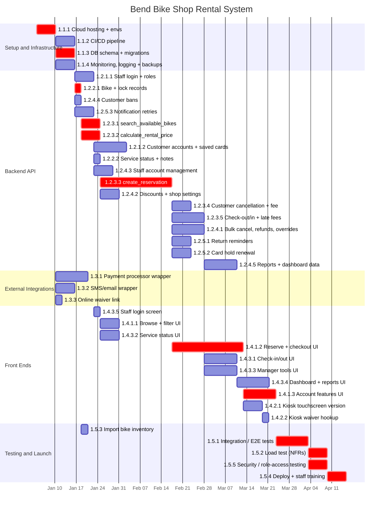

# Bend Bike Shop Schedule

Estimates for the Bend Bike Shop rental system described in [design_doc.md](design_doc.md).  All times are in working days.

## Work Breakdown Structure

### Estimation guide

These are rough solo estimates, including time to learn unfamiliar tools and debug normal mistakes.  They assume part-time work of about 10-15 hours per week; calendar time will be longer if you work fewer hours.

- **S** = 1-3 working days
- **M** = 4-8 working days
- **L** = 1-3 working weeks
- **XL** = 3-6 working weeks

The sizes on parent categories are rough roll-ups, not additional work.  Unit tests are written as part of each task, not saved for the end.

- **1 Bend Bike Shop Rental System — XL**
  - **1.1 Setup & Infrastructure — L**
    - 1.1.1 Cloud hosting + dev/prod environments — **M**
    - 1.1.2 CI/CD pipeline — **M**
    - 1.1.3 Database schema + migrations — **M**
    - 1.1.4 Monitoring, logging + backups — **M**
  - **1.2 Backend API — XL**
    - 1.2.1 Auth & Roles — **L**
      - 1.2.1.1 Staff login + role checks — **M**
      - 1.2.1.2 Optional customer accounts + saved cards — **L**
    - 1.2.2 Inventory — **M**
      - 1.2.2.1 Bike + lock count records — **S**
      - 1.2.2.2 Service status + service notes — **S**
    - 1.2.3 Reservations — **XL**
      - 1.2.3.1 search_available_bikes — **M**
      - 1.2.3.2 calculate_rental_price — **M**
      - 1.2.3.3 create_reservation (transaction, ban check, pre-auth) — **XL**
      - 1.2.3.4 Customer cancellation + fee — **M**
      - 1.2.3.5 Check-out / check-in + late fees — **L**
    - 1.2.4 Manager Tools — **XL**
      - 1.2.4.1 Bulk cancel, refunds, overrides — **L**
      - 1.2.4.2 Discounts + shop settings — **M**
      - 1.2.4.3 Staff account management — **M**
      - 1.2.4.4 Customer bans — **S**
      - 1.2.4.5 Reports + live dashboard data — **L**
    - 1.2.5 Scheduled Jobs — **L**
      - 1.2.5.1 Return reminders — **M**
      - 1.2.5.2 Card hold renewal — **M**
      - 1.2.5.3 Notification retries — **M**
  - **1.3 External Integrations — L**
    - 1.3.1 Payment processor wrapper — **L**
    - 1.3.2 SMS/email wrapper — **M**
    - 1.3.3 Online waiver link — **S**
  - **1.4 Front Ends — XL**
    - 1.4.1 Customer Web App — **XL**
      - 1.4.1.1 Browse + filter — **M**
      - 1.4.1.2 Reserve + checkout flow — **XL**
      - 1.4.1.3 Account features (autofill, saved cards, Rent Again) — **L**
    - 1.4.2 Kiosk App — **M**
      - 1.4.2.1 Touchscreen version of the web app — **M**
      - 1.4.2.2 Waiver hookup — **S**
    - 1.4.3 Staff Dashboard — **XL**
      - 1.4.3.1 Check-in/out + flagged reservations — **L**
      - 1.4.3.2 Service status screens — **M**
      - 1.4.3.3 Manager tools UI — **L**
      - 1.4.3.4 Live dashboard + reports UI — **L**
      - 1.4.3.5 Staff login screen — **S**
  - **1.5 Testing & Launch — L**
    - 1.5.1 Integration / end-to-end tests — **L**
    - 1.5.2 Load test against the NFRs — **M**
    - 1.5.3 Import existing bike inventory — **S**
    - 1.5.4 Deploy + staff training — **M**
    - 1.5.5 Security / role-access testing — **M**

## PERT Inputs

Each leaf task's size maps to PERT inputs using the ranges in the estimation guide: O is the low end, P is the high end, and M sits 60% of the way from O to P, since tasks run long more often than short.

| Size | O | M | P | PERT duration (O + 4M + P) / 6 |
|---|---|---|---|---|
| S | 1 | 2.2 | 3 | 2.13 |
| M | 4 | 6.4 | 8 | 6.27 |
| L | 5 | 11 | 15 | 10.67 |
| XL | 15 | 24 | 30 | 23.5 |

## Monte Carlo Estimate

10,000 simulated runs, sampling each task from a beta-PERT distribution over its O/M/P and walking the dependency graph to get the finish time of each run.

| Scenario | P50 | **P90** |
|---|---|---|
| Parallel work (independent branches worked at the same time, matches the CPM table) | 104 days | **110 days** |
| Solo developer (every task done one after another) | 294 days | **304 days** |

**P90 estimate: 110 working days** if independent branches can be worked in parallel.  Since the estimates are solo beginner estimates, the realistic P90 for one person working alone is **304 working days**.

## CPM Table

Durations are PERT durations in working days.  Rows in **bold** are on the critical path (zero slack).

| Task | Duration | Dependencies | ES | EF | LS | LF | Slack |
|---|---|---|---|---|---|---|---|
| **1.1.1 Cloud hosting + envs** | 6.27 | none | 0 | 6.27 | 0 | 6.27 | 0 |
| 1.1.2 CI/CD pipeline | 6.27 | 1.1.1 | 6.27 | 12.53 | 72.33 | 78.6 | 66.07 |
| **1.1.3 DB schema + migrations** | 6.27 | 1.1.1 | 6.27 | 12.53 | 6.27 | 12.53 | 0 |
| 1.1.4 Monitoring, logging + backups | 6.27 | 1.1.1 | 6.27 | 12.53 | 89.27 | 95.53 | 83 |
| 1.2.1.1 Staff login + roles | 6.27 | 1.1.3 | 12.53 | 18.8 | 40.33 | 46.6 | 27.8 |
| 1.2.1.2 Customer accounts + saved cards | 10.67 | 1.2.1.1, 1.3.1 | 18.8 | 29.47 | 57.27 | 67.93 | 38.47 |
| **1.2.2.1 Bike + lock records** | 2.13 | 1.1.3 | 12.53 | 14.67 | 12.53 | 14.67 | 0 |
| 1.2.2.2 Service status + notes | 2.13 | 1.2.2.1, 1.2.1.1 | 18.8 | 20.93 | 70.2 | 72.33 | 51.4 |
| **1.2.3.1 search_available_bikes** | 6.27 | 1.2.2.1 | 14.67 | 20.93 | 14.67 | 20.93 | 0 |
| **1.2.3.2 calculate_rental_price** | 6.27 | 1.2.2.1 | 14.67 | 20.93 | 14.67 | 20.93 | 0 |
| **1.2.3.3 create_reservation** | 23.5 | 1.2.3.1, 1.2.3.2, 1.2.4.4, 1.3.1, 1.3.2 | 20.93 | 44.43 | 20.93 | 44.43 | 0 |
| 1.2.3.4 Customer cancellation + fee | 6.27 | 1.2.3.3 | 44.43 | 50.7 | 72.33 | 78.6 | 27.9 |
| 1.2.3.5 Check-out/in + late fees | 10.67 | 1.2.3.3, 1.2.1.1 | 44.43 | 55.1 | 46.6 | 57.27 | 2.17 |
| 1.2.4.1 Bulk cancel, refunds, overrides | 10.67 | 1.2.3.3 | 44.43 | 55.1 | 57.27 | 67.93 | 12.83 |
| 1.2.4.2 Discounts + shop settings | 6.27 | 1.2.3.2, 1.2.1.1 | 20.93 | 27.2 | 61.67 | 67.93 | 40.73 |
| 1.2.4.3 Staff account management | 6.27 | 1.2.1.1 | 18.8 | 25.07 | 61.67 | 67.93 | 42.87 |
| 1.2.4.4 Customer bans | 2.13 | 1.1.3 | 12.53 | 14.67 | 18.8 | 20.93 | 6.27 |
| 1.2.4.5 Reports + dashboard data | 10.67 | 1.2.3.5 | 55.1 | 65.77 | 57.27 | 67.93 | 2.17 |
| 1.2.5.1 Return reminders | 6.27 | 1.2.3.3 | 44.43 | 50.7 | 72.33 | 78.6 | 27.9 |
| 1.2.5.2 Card hold renewal | 6.27 | 1.2.3.3 | 44.43 | 50.7 | 72.33 | 78.6 | 27.9 |
| 1.2.5.3 Notification retries | 6.27 | 1.3.2 | 12.53 | 18.8 | 72.33 | 78.6 | 59.8 |
| 1.3.1 Payment processor wrapper | 10.67 | 1.1.1 | 6.27 | 16.93 | 10.27 | 20.93 | 4 |
| 1.3.2 SMS/email wrapper | 6.27 | 1.1.1 | 6.27 | 12.53 | 14.67 | 20.93 | 8.4 |
| 1.3.3 Online waiver link | 2.13 | 1.1.1 | 6.27 | 8.4 | 74.33 | 76.47 | 68.07 |
| 1.4.1.1 Browse + filter UI | 6.27 | 1.2.3.1 | 20.93 | 27.2 | 72.33 | 78.6 | 51.4 |
| **1.4.1.2 Reserve + checkout UI** | 23.5 | 1.2.3.3 | 44.43 | 67.93 | 44.43 | 67.93 | 0 |
| **1.4.1.3 Account features UI** | 10.67 | 1.2.1.2, 1.4.1.2 | 67.93 | 78.6 | 67.93 | 78.6 | 0 |
| 1.4.2.1 Kiosk touchscreen version | 6.27 | 1.4.1.2 | 67.93 | 74.2 | 70.2 | 76.47 | 2.27 |
| 1.4.2.2 Kiosk waiver hookup | 2.13 | 1.4.2.1, 1.3.3 | 74.2 | 76.33 | 76.47 | 78.6 | 2.27 |
| 1.4.3.1 Check-in/out UI | 10.67 | 1.4.3.5, 1.2.3.5 | 55.1 | 65.77 | 67.93 | 78.6 | 12.83 |
| 1.4.3.2 Service status UI | 6.27 | 1.4.3.5, 1.2.2.2 | 20.93 | 27.2 | 72.33 | 78.6 | 51.4 |
| 1.4.3.3 Manager tools UI | 10.67 | 1.4.3.5, 1.2.4.1, 1.2.4.2, 1.2.4.3, 1.2.4.4 | 55.1 | 65.77 | 67.93 | 78.6 | 12.83 |
| 1.4.3.4 Dashboard + reports UI | 10.67 | 1.4.3.5, 1.2.4.5 | 65.77 | 76.43 | 67.93 | 78.6 | 2.17 |
| 1.4.3.5 Staff login screen | 2.13 | 1.2.1.1 | 18.8 | 20.93 | 65.8 | 67.93 | 47 |
| **1.5.1 Integration / E2E tests** | 10.67 | 1.4.1.1, 1.4.1.3, 1.4.2.2, 1.4.3.1, 1.4.3.2, 1.4.3.3, 1.4.3.4, 1.2.3.4, 1.2.5.1, 1.2.5.2, 1.2.5.3, 1.1.2 | 78.6 | 89.27 | 78.6 | 89.27 | 0 |
| **1.5.2 Load test (NFRs)** | 6.27 | 1.5.1 | 89.27 | 95.53 | 89.27 | 95.53 | 0 |
| 1.5.3 Import bike inventory | 2.13 | 1.2.2.1 | 14.67 | 16.8 | 93.4 | 95.53 | 78.73 |
| **1.5.4 Deploy + staff training** | 6.27 | 1.5.2, 1.5.3, 1.5.5, 1.1.4 | 95.53 | 101.8 | 95.53 | 101.8 | 0 |
| **1.5.5 Security / role-access testing** | 6.27 | 1.5.1 | 89.27 | 95.53 | 89.27 | 95.53 | 0 |

**Critical path:** 1.1.1 → 1.1.3 → 1.2.2.1 → 1.2.3.1 → 1.2.3.2 → 1.2.3.3 → 1.4.1.2 → 1.4.1.3 → 1.5.1 → 1.5.2 → 1.5.5 → 1.5.4  (101.8 working days)

## LLM Review Changes

I gave the design doc and the first draft of this schedule to an LLM, asked it to find missing components and sanity check the estimates, and kept these changes:

- **Added 1.1.4 Monitoring, logging + backups (M).**  Needed to meet the 99.5% uptime target and keep rental records for 2 years.
- **Added 1.4.3.5 Staff login screen (S).**  The backend had login, but no UI task covered it.
- **Added 1.5.5 Security / role-access testing (M).**  Refunds and overrides are manager-only, so role checks need their own testing.
- **Integration / E2E tests XL → L.**  Unit tests now happen inside each task instead of one big block at the end.
- **Load test L → M.**  50 concurrent users and about 60 rentals a day is a light load.
- **Card hold renewal L → M.**  It's a scheduled job about the size of return reminders.
- **Kiosk touchscreen version L → M.**  The customer web app is already mobile-friendly, so the kiosk is mostly reuse.
- **Most likely (M) moved from the midpoint to 60% of each range, toward the long end.**  Tasks run late more often than early, so the original midpoint estimates were optimistic.

## Gantt Chart

Built from the CPM table, starting on an example date.  Each day on the chart is one working day; weekends aren't skipped.  Critical path tasks are highlighted.

